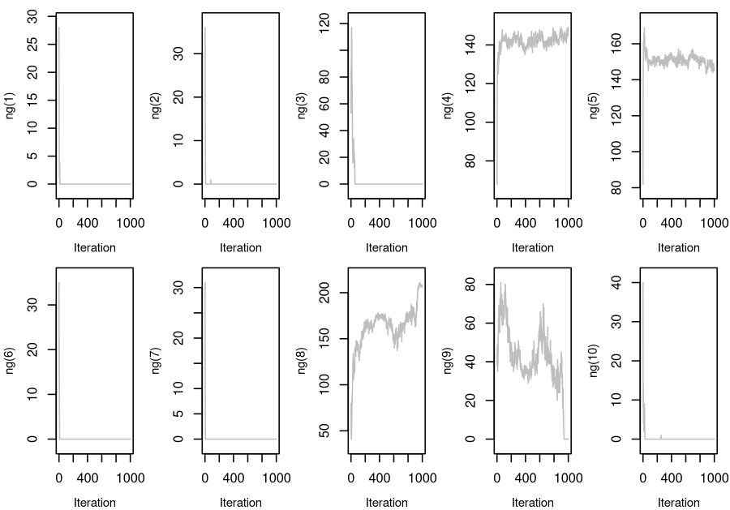
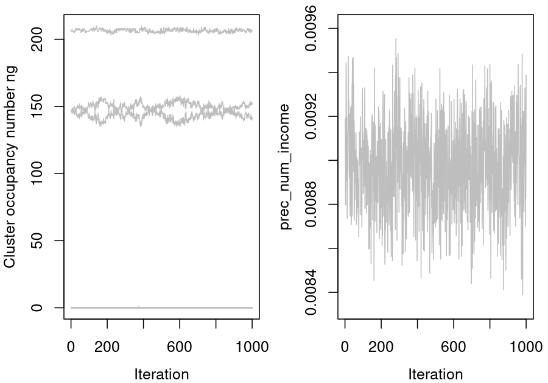
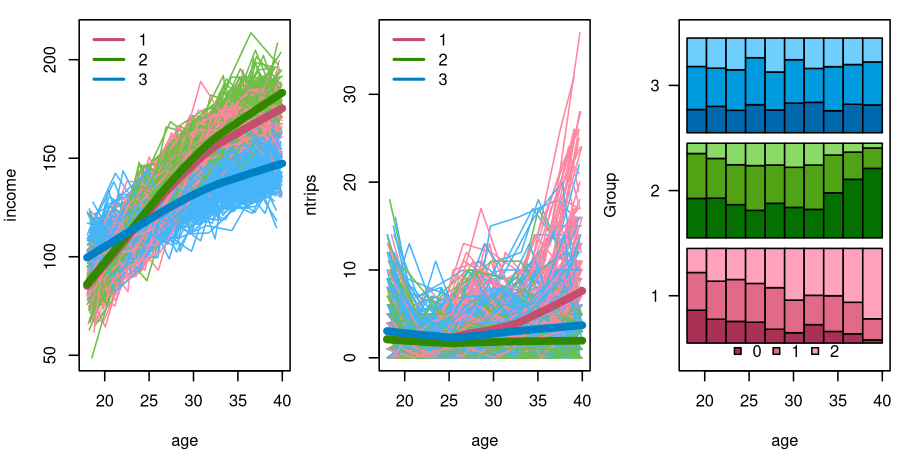

<!-- README.md is generated from README.Rmd. Please edit that file -->

# clustGLMM

## Overview

The R package [clustGLMM](https://CRAN.r-project.org/package=clustGLMM/)
provides tools for Bayesian estimation and inference for modelling
clusterwise multivariate regression models for numeric, count, binary,
ordinal and count outcomes observed repeatedly on the same units and
where possible relations among outcomes are captured through a joint
distribution of random effects. The clusters are defined through
cluster-specific parameters, which the analyst can choose, e.g., with
respect to the regression coefficients. In particular, the model
specification for each regression model via the formula is specific to
the outcome and consists of four parts: (1) fixed - regression
coefficients common to all clusters, (2) group - group-specific
regression coefficients, (3) random - random effects specific for each
unit, (3) offset - name of an offset variable (if needed). Estimation is
performed using MCMC sampling combining Gibbs and Metropolis-Hastings
steps. Post-processing tools allow to assess convergence and address
label switching and provide visual diagnostics. Units may be classified
based on sampled allocation indicators or by exploiting the posterior
distribution of the classification probabilities. For more details see
Vavra et al. (2024,
[doi:10.1007/s11222-023-10304-5](https://doi.org/10.1007/s11222-023-10304-5))

## Installation

The stable version of `clustGLMM` is available on
[CRAN](https://CRAN.R-project.org/package=clustGLMM) and can be
installed using:

``` r
install.packages("clustGLMM")
```

## License

The package is available under the [General Public License version
2](https://www.gnu.org/licenses/old-licenses/gpl-2.0.html).

## Illustration

Package and data can be loaded via:

``` r
library("clustGLMM")
data("psurvey", package = "clustGLMM")
```

First, the inputs are prepared:

``` r
family <- c(income = "num", ntrips = "poi", satisfaction = "ord") 
formula <- list()
formula[["income"]] <- list(fixed = ~ 0, group = ~ age + I(age^2), random = ~ 1)
for (y in c("ntrips", "satisfaction")) {
  formula[[y]] <- list(fixed = ~ 0, group = ~ age, random = ~ 1)
}
varying <- default_varying(prec_num = FALSE)
param <- default_param(prec_num_rte = 15, e0_rte = 200)  
```

Then, MCMC sampling is performed:

``` r
set.seed(12345678)
mcmc_burnin <- clustGLMM(formula, id = "i", family, data = psurvey, G = 10, 
                         varying = varying, param = param, iter = 1000)
```

To assess convergence, the occupance numbers of the components over the
iterations is inspected:

``` r
plot(mcmc_burnin, ng_trace_chain_split = FALSE)
```



The tuning parameters are changed before continuing the MCMC sampling to
reduce acceptance rates:

``` r
tuning <- default_tuning(const_proposal_e0 = 4.5, const_proposal_beta_poi = 2,  
  const_proposal_beta_ord = 4, const_proposal_a_ord = 2.2, const_proposal_b = 1.5)
```

Then, MCMC sampling is continued:

``` r
set.seed(1234)
mcmc <- clustGLMM(formula, id = "i", family, data = psurvey, G = 10, 
                  varying = varying, param = param, iter = 1000, 
                  inits = mcmc_burnin$last)
```

Again visual diagnostics are inspected to assess convergence:

``` r
par(mfrow = c(1, 2))
plot(mcmc, ng_trace_chain_split = TRUE, setparmfrow = FALSE)
plot(mcmc, what = "prec_num", yspec = "income", setparmfrow = FALSE)
```



Post-processing is performed to obtain an identified model:

``` r
set.seed(123456)
(mcmc_pp <- post_processing(mcmc))
```

    ## ###------------------------------------------###
    ## ### Post-processed MCMC samples of clustGLMM ###
    ## ###------------------------------------------###
    ## -----------------------------------------------------------------------
    ## Chain 1
    ## -----------------------------------------------------------------------
    ## The new number of components for this chain: $G[1] = 3.
    ## We now have components: 1, 2, 3.
    ## Number of iterations with 3 components: 999 ( 99.90 %)
    ## Out of them, 0 (0.00 %) did not lead to a permutation when using k-means, these
    ## g-specific parameters are replaced with NA.
    ## Therefore, 999 (100.00 %) iterations have been permuted and aligned. These are now
    ## eligible for the analysis.

The posterior distribution of the parameters can be inspected, e.g., the
parameters of cluster 1 corresponding to the dependent variable
`ntrips`:

``` r
sum_mcmc <- summary(mcmc_pp, burnin = 0, thin = 1)
print(sum_mcmc, which = "group_param", clusters = 1, pattern = "ntrips")
```

    ## -----------------------------------------------------------------------
    ## Chain 1
    ## -----------------------------------------------------------------------
    ## 
    ## Summary of the parameter estimates
    ## -----------------------------------------------------------------------
    ## Parameters specific for cluster g=1:
    ##                            Effect        2.5%         25%         50%       Mean
    ## beta_poi_ntrips(1)[1] (Intercept) -1.31467038 -1.18195651 -1.13156031 -1.1368997
    ## beta_poi_ntrips(1)[2]         age  0.07480618  0.07715431  0.07854806  0.0785877
    ##                               75%       97.5%
    ## beta_poi_ntrips(1)[1] -1.07528402 -0.98680941
    ## beta_poi_ntrips(1)[2]  0.07982884  0.08324393

The clustering solution can also be inspected:

``` r
print(mcmc_pp, which = "clustering")
```

    ## ## Clustering based on sampled indicators:
    ## -----------------------------------------------------------------------
    ## Chain 1
    ## -----------------------------------------------------------------------
    ## The most-frequent number of non-empty components: 3
    ## Empty components: 
    ## Non-empty components: 1, 2, 3
    ##   1   2   3 
    ## 144 151 205 
    ## Average certainty of assignment to a component: 
    ##         1         2         3 
    ## 0.9694069 0.9754788 0.9994580

The data is plotted using the identified clustering to cluster the
observations:

``` r
psurvey$Uclustering <- mcmc_pp$clustering[psurvey$i, 1]
par(mar = c(4, 4, 1, 0.5), mfrow = c(1, 3))
plot_num_vs_x_grouped(psurvey, "income", x = "age",  id = "i", group = "Uclustering",
                      add_lowess = TRUE, legend_placement = "topleft")
plot_num_vs_x_grouped(psurvey, "ntrips", x = "age",  id = "i", group = "Uclustering",
                      add_lowess = TRUE, legend_placement = "topleft")
plot_cat_vs_x_grouped(psurvey, "satisfaction", x = "age", group = "Uclustering")
```



## References

Vávra, J., Komárek, A., Grün, B., Malsiner-Walli, G. Clusterwise
multivariate regression of mixed-type panel data. Stat Comput 34, 46
(2024). <https://doi.org/10.1007/s11222-023-10304-5>
