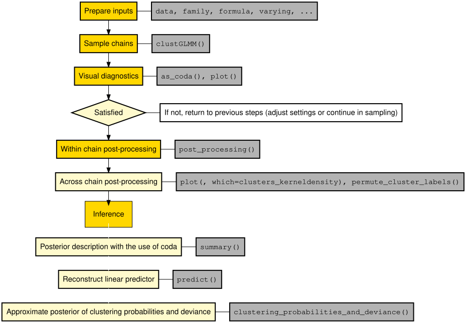

<!--
output:
  rjtools::rjournal_pdf_article:
    self_contained: yes
    toc: no
always_allow_html: true
-->

```{r setup, include=FALSE}
library(knitr)
knitr::opts_chunk$set(echo = FALSE, warning = FALSE, message = FALSE, fig.path = "figure-latex/")
options(tinytex.verbose = TRUE, width = 90, digits = 3)
# options(width = 110) # does not change the template
library("clustGLMM")

combine <- function(x, sep, width) {
  cs <- cumsum(nchar(x))
  remaining <- if (any(cs[-1] > width)) combine(x[c(FALSE, cs[-1] > width)], sep, width)
  c(paste(x[c(TRUE, cs[-1] <= width)], collapse= sep), remaining)
}
prettyPrint <- function(x, sep = " ", linebreak = "\n\t", width = getOption("width")) {
    x <- strsplit(x, sep)[[1]]
    paste(combine(x, sep, width), collapse = paste(sep, linebreak, collapse = ""))
}  

# 1. Save the default output behavior
hook_output <- knit_hooks$get("output")

# 2. Create a custom hook to filter text lines
knit_hooks$set(output = function(x, options) {
  lines <- options$output.lines
  if (is.null(lines)) {
    return(hook_output(x, options)) # Pass to default if option isn't used
  }
  
  # Split the output into individual rows
  x <- unlist(strsplit(x, "\n"))
  more <- "..."
  
  # Handle negative indexing (omitting specific rows)
  if (any(lines < 0)) {
    x <- x[lines]
  } else {
    # Handle positive indexing (keeping specific rows)
    if (length(lines) == 1) {
      if (length(x) > lines) {
        x <- c(head(x, lines), more)
      }
    } else {
      x <- c(more, x[lines], more)
    }
  }
  
  # Recombine into a single string block
  x <- paste(c(x, ""), collapse = "\n")
  hook_output(x, options)
})
```

# Introduction {#sec:introduction}

Clustering longitudinal multivariate data is a\ key task in many fields, including medicine, psychology, and the social sciences, where repeated measurements of heterogeneous types are commonly collected for individuals. These data usually consist of a\ combination of continuous, count, binary, ordinal, and nominal outcome variables which are predicted through explanatory variables. Modeling such data structures in a\ clustering context using a\ multivariate regression setup requires the flexibility to jointly account for individual random effects and group-specific heterogeneity.

This indicates the need for a\ unified, flexible, and extensible implementation for clustering mixed-type longitudinal data within a\ fully probabilistic framework based on a\ mixture model of multivariate generalized linear mixed models. Several R packages address only parts of this problem as they only allow to fit simplified versions of this model. Package \CRANpkg{lcmm} [@Proust-Lima-etal2017] provides tools to estimate latent class mixed models for continuous and categorical outcomes, but does not cover the full range of outcome types from the generalized linear modeling framework. Package \CRANpkg{flexmix} [@Leisch04flexmix] supports finite mixture modeling with customizable components, with the currently available model drivers not covering the non-Gaussian case of a\ mixed model and a\ multivariate approach requiring the conditional independence assumption. Packages such as \CRANpkg{MCMCglmm} [@Hadfield10MCMCglmm] and \CRANpkg{mixAK} [@KomarekKomarkovaJSS14mixAK] offer Bayesian inference via Markov chain Monte Carlo (MCMC) sampling for generalized linear mixed models and mixture models, but require specialized formulations and offer limited clustering functionalities for mixed outcomes.

To address these limitations, we introduce the R package \pkg{clustGLMM}, which implements a\ Bayesian model-based clustering framework for longitudinal data with mixed outcome types as described by @Vavra-etal2024. The package models the data using a\ mixture of generalized linear mixed models (GLMMs), allowing for a\ flexible specification of outcome distributions and random effects. Inference is performed via MCMC sampling, the outputs are compatible with package \CRANpkg{coda} [@Plummer06coda], enabling a\ full posterior characterization of both, model parameters and latent cluster assignments.

By focusing specifically on clustering, \pkg{clustGLMM} fills a\ gap between general-purpose Bayesian modeling tools and more specialized latent class or mixture modeling packages, offering a\ practical and extensible solution for researchers working with complex longitudinal data. In particular, a\ number of post-processing procedures are provided to  inspect and assess the posterior MCMC draws, but also to identify cluster distributions and classify observations to allow for a\ convenient use in clustering applications. 

All computations and graphics in this paper have been done with \pkg{clustGLMM} version `r packageVersion("clustGLMM")` and R version `r getRversion()` using R Markdown. The newest release version of \pkg{clustGLMM} is always available from the Comprehensive R Archive Network (CRAN) at [https://CRAN.R-project.org/package=clustGLMM](https://CRAN.R-project.org/package=clustGLMM "clustGLMM"), an up-to-date version of this paper is contained as a\ package vignette.

# Methodology {#sec:methodology}

In this section, we briefly outline the model for clustering multivariate longitudinal data of mixed-type implemented in package \pkg{clustGLMM}. In addition to the model specification, we also discuss the prior structure and the hyperparameters required for the Bayesian approach. More details can be found in @Vavra-etal2024.

## Modeling longitudinal mixed-type outcomes {#subsec:glmms}

We start with explaining the necessary notation. We consider a\ multivariate regression setting where the indices for the outcomes are contained in the set $\mathcal{R}$. The index $r\in\mathcal{R}$ denotes one specific outcome variable and $\mathcal{R}$ is the union of five disjoint sets of indices: $\mathcal{R}^{\mathsf{Num}}$, $\mathcal{R}^{\mathsf{Poi}}$, $\mathcal{R}^{\mathsf{Bin}}$, $\mathcal{R}^{\mathsf{Ord}}$, $\mathcal{R}^{\mathsf{Cat}}$. Each set contains the indices for one of the five different outcome types considered: numeric, count, binary, ordinal and nominal. 

We assume that the data provided is collected for $n$ individuals with observations possibly made for each individual at different observation points resulting in a\ potentially different number of observations for each individual. We denote outcome $r\in\mathcal{R}$ of individual $i=1, \ldots, n$ from the $j$-th time point, $j = 1, \ldots, n_i$, by $Y_{ij}^r$, which together form a dataset of $N = \sum_{i=1}^n n_i$ rows. These observations are accompanied by explanatory variables which are split into two regression vectors $\mathbf{X}_{ijr}$ and $\mathbf{Z}_{ijr}$ to distinguish the model matrix for the fixed and random effects in the mixed-effects model, respectively. Note that each outcome $r$ is allowed to have a\ different set of regressors. Thus, the linear predictor 
$$
\eta_{ijr} = \mathbf{X}_{ijr}^\top \boldsymbol{\beta}_r + \mathbf{Z}_{ijr}^\top \mathbf{b}_{i}^r,
$$
with fixed effects $\boldsymbol{\beta}_r$ and individual-specific random effects $\mathbf{b}_{i}^r$ represents the main part for modeling outcome $r$. 

For each outcome we consider one of five different types of GLMMs, i.e., different specifications of the response distribution and the link function which relates the mean to the linear predictor. In particular, we distinguish the following regression models: 

* We consider normal linear mixed-effects models for a\ quantitative (numeric) outcome $r\in\mathcal{R}^{\mathsf{Num}}$. This requires an additional dispersion parameter which captures the variability of the regression errors. As usual in Bayesian statistics, we parameterize the normal distribution via the precision parameter $\tau_r>0$. 
* For count outcomes, $r\in\mathcal{R}^{\mathsf{Poi}}$, we consider the Poisson distribution with the log link. This specification does not require any additional model parameter. 
* Binary outcomes, $r\in\mathcal{R}^{\mathsf{Bin}}$, are modeled by a\ logistic regression with the logit link function $\mathsf{logit}(x) = \log (x/(1-x))$. 

If the number of categories, $K^r$, is higher than 2, we consider the following two specifications:

* If an ordering of the categories (labeled $0 < \ldots < K^r -1$) is possible, we apply the proportional odds assumption, i.e., the log-odds differ only in intercepts $c_{r,k}$. In this case the intercept is excluded and this effect is modeled through a\ separate parameter because the following ordering constraint needs to be satisfied: $-\infty = c_{r,-1} < c_{r,0} < \cdots < c_{r,K^r-1} = \infty$, which requires a\ special prior and sampling approach. 
* If categories (labeled again as $0, \ldots, K^r -1$) cannot be ordered or the proportional odds assumption does not apply, then we create a\ linear predictor specific for each category, $\eta_{ijrk}$, with category-specific fixed effects $\boldsymbol{\beta}_{r,k}$. The random effects $\mathbf{b}_{ik}^r$ might also either be category-specific or alternatively common to all categories except the first. For identifiability, we fix the first category to zero: $\boldsymbol{\beta}_{r,0} = \mathbf{0}$ and $\mathbf{b}_{i0}^r$ leading to $\eta_{ijr0} = 0$.

The probability distributions of the observed outcomes given the linear predictors and auxiliary model parameters can be summarized in the following way:
\begin{align*}
  \left. Y_{ij}^r \,\right\vert\, \boldsymbol{\beta}_r, \mathbf{b}_i^r, \mathbf{X}_{ijr}, \mathbf{Z}_{ijr} 
  &\sim 
  \mathsf{N}\left(\eta_{ijr}, \; \tau_r^{-1}\right), 
  &\qquad r \in\mathcal{R}^{\mathsf{Num}}, 
  \\
  \left. Y_{ij}^r \,\right\vert\, \boldsymbol{\beta}_r, \mathbf{b}_i^r, \mathbf{X}_{ijr}, \mathbf{Z}_{ijr} 
  &\sim 
  \mathsf{Pois}\left(\exp\left\{\eta_{ijr}\right\}\right), 
  &\qquad r \in\mathcal{R}^{\mathsf{Poi}},
  \\
  \mathsf{P} \left[\left. Y_{ij}^r = 1 \,\right\vert\, \boldsymbol{\beta}_r, \mathbf{b}_i^r, \mathbf{X}_{ijr}, \mathbf{Z}_{ijr} \right] 
  &= 
  \mathsf{logit}^{-1} \left(\eta_{ijr}\right), 
  &\qquad r \in\mathcal{R}^{\mathsf{Bin}},
  \\
  \mathsf{P} \left[\left. Y_{ij}^r > k \,\right\vert\, c_{r,k}, \boldsymbol{\beta}_r, \mathbf{b}_i^r, \mathbf{X}_{ijr}, \mathbf{Z}_{ijr} \right] 
  &= 
  \mathsf{logit}^{-1} \left(\eta_{ijr} - c_{r,k}\right), 
  &\qquad k = 0, 1, \ldots, K^r-1, \;r \in\mathcal{R}^{\mathsf{Ord}},
  \\
  \mathsf{P} \left[\left. Y_{ij}^r = k \,\right\vert\, \boldsymbol{\beta}_r, \mathbf{b}_i^r, \mathbf{X}_{ijr}, \mathbf{Z}_{ijr} \right] 
  &= 
  \frac{\exp (\eta_{ijkr})}{1 + \sum\limits_{\kappa=1}^{K^r-1} \exp (\eta_{ij\kappa r})}, 
  &\qquad k = 0, 1, \ldots, K^r-1, \;r \in\mathcal{R}^{\mathsf{Cat}}.
\end{align*}

Assuming independence among the set of outcomes for the same individual is often unrealistic. Hence, we opt for a\ joint modeling approach which captures the dependency between the observations of the same individual. In particular, we stack the random effects for each individual $i$ into one vector $\mathbf{b}_{i} = \{\mathbf{b}_{i}^r, r\in\mathcal{R}\}$ with length denoted by $d^R$ and assume that they follow independently across individuals a\ multivariate normal distribution, $\mathbf{b}_{i} \sim \mathsf{N}_{d^R}(\mathbf{0}, \boldsymbol{\Sigma})$ where $\boldsymbol{\Sigma}$ is a\ positive definite matrix. This implies that the outcomes for the same individual are marginally dependent. However, they are still independent conditional on the random effects. 

## Model-based clustering of GLMMs {#subsec:mbc-glmms}

The model described in the previous section assumes that all individuals within the random sample follow the same, homogeneous model conditional on the explanatory variables. In case unobserved heterogeneity is present in the sample, this approach provides misleading results. We thus extend our model and consider a\ model-based clustering approach where we assume the presence of $G$ latent groups. Each group follows the model outlined in the previous section but possibly differs in the values of the parameters. E.g., the groups may differ in the fixed-effects regression parameters, in the error precision of the numeric outcome and / or in the dependence structure of the random effects. Our implementation allows to flexibly choose which model parameters are group-specific and which ones are fixed to be the same across all latent groups.

The specification which parameters are group-specific and which are the same across all latent groups will usually depend on what is assumed to characterize the latent groups. In addition imposing the restriction that some of the effects are the same across groups simplifies the model and facilitates estimation and interpretation. In the following, we will denote group-specific parameters with a\ superscript $(g)$, e.g., $\tau_r^{(g)}$. Parameters without this superscript are parameters which are the same across groups or represent the set of the corresponding parameters across all groups depending on context. Turning group-specificity on or off will be made en bloc for auxiliary model parameters like $\tau_r$, $\mathbf{c}_r$ or $\boldsymbol{\Sigma}$. For the fixed effects, a\ more selective approach is usually pursued with some effects being assumed to be the same across all groups, while others differ across groups. I.e., we split the fixed-effects contribution to the linear predictor into two parts such that the linear predictor for group $g$ takes the form of 
$$
\eta_{ijr}^{(g)} = \mathbf{F}_{ijr}^\top \boldsymbol{\beta}_r^F + \mathbf{X}_{ijr}^\top \boldsymbol{\beta}_r^{(g)} + \mathbf{Z}_{ijr}^\top \mathbf{b}_{ir},
$$
where $\boldsymbol{\beta}_r^F$ are the fixed effects shared among all groups  and $\boldsymbol{\beta}_r^{(g)}$ are the fixed effects specific to group $g$. Naturally, the sets of regressors $\mathbf{F}_{ijr}$ and $\mathbf{X}_{ijr}$ need to be mutually exclusive to avoid identifiability issues. 

Each individual $i$ belongs to one of the groups. Group membership is assumed to be unobserved and given by the latent group allocation indicator $U_i \in \{1, \ldots, G\}$. The group size corresponds to the marginal group allocation probabilities $w_g = \mathsf{P}(U_i = g)$ that sum up to one over $g = 1, \ldots, G$. Marginalizing over the latent group allocation indicators, we obtain a\ mixture distribution where the components consist of multivariate generalized linear mixed models and the probability density function (pdf) is given by:
\begin{equation}
  p(\mathbb{Y}_i \,\vert\, \mathcal{C}_i)
  = \sum\limits_{g=1}^{G} 
  w_g \int 
  p\left(\mathbb{Y}_i \,\left\vert\, U_i = g, \mathbf{b}_i;\, \boldsymbol{\beta}^F, \boldsymbol{\beta}^{(g)}, \boldsymbol{\tau}^{(g)}, \mathbf{c}^{(g)}, \mathcal{C}_i \right.\right)
  p\left(\mathbf{b}_i \,\left\vert\, U_i = g;\, \boldsymbol{\Sigma}^{(g)}\right.\right)
  \mathrm{d} \mathbf{b}_i,
  (\#eq:pdf-int-bi-Ui)
\end{equation}
where $p(\,\vert\,)$ denotes the conditional pdf, $\mathbb{Y}_i = \{Y_{ij}^r, \, j = 1, \ldots, n_i, \, r \in\mathcal{R}\}$ gathers all outcome values observed for individual $i$ and $\mathcal{C}_i = \{\mathbb{F}_{i}, \mathbb{X}_{i}, \mathbb{Z}_{i}\}$ gathers the covariates for individual $i$. Due to the general model specification with different distributions for the dependent variables, the integral over the random effects $\mathbf{b}_i$ cannot be analytically evaluated. In Bayesian estimation using MCMC sampling, we avoid these integrals by not marginalizing over the random effects, but performing Bayesian data augmentation and working with the conditional distributions. 

## Priors {#subsec:priors}

Within the Bayesian context, we need to specify prior distributions for all model parameters. We choose conditionally conjugate priors whenever possible to obtain well known full-conditional distributions. We distinguish between selecting priors for the component-specific parameters and the component sizes. 

In Bayesian mixture modeling, the priors on the group-specific parameters in the components need to be proper to obtain a\ proper posterior, and in general, hyperparameters inducing a\ certain regularization are preferable. We standardize numeric outcome variables and non-intercept regressors by  default to ensure that the priors with the default hyperparameters impose a\ comparable shrinkage on the regression coefficients, error precision and random effect covariance regardless of the specific scaling of the variables. This standardization does not only change the fixed and random effects (especially intercepts), but also the precision $\tau_r$, the ordered intercepts $\mathbf{c}_{r}$ as well as the covariance matrix $\boldsymbol{\Sigma}$. In order to be able to interpret the parameter estimates with respect to the original scaling, the back-transformed parameters are reported in the output.

All the fixed effects are given an independent centered normal prior, where the scale is adjusted depending on the outcome type. For numeric outcomes, the precision parameter $\tau_r$ is included within the normal prior for fixed effects $\boldsymbol{\beta}_r^F$ and $\boldsymbol{\beta}_r^{(g)}$. The precision $\tau_r$ is given a\ gamma prior to complete the normal-gamma prior family for linear regression models. For the ordered intercepts of ordinal outcomes, we use an implicit prior by imposing a\ symmetric Dirichlet prior on the induced category probabilities given the ordered intercepts and a\ zero effect of the linear predictor:
\begin{align*}
\pi_{r,k}^{(g)} 
&= \mathsf{P}\left[Y_{ijr} = k \,\vert\, \eta_{ijr} = 0, U_i = g\right]
= \mathsf{logit}^{-1}(c_{r,k-1}^{(g)}) - \mathsf{logit}^{-1}(c_{r,k}^{(g)}).
\end{align*}

Pursuing a\ conditional conjugate specification, we use the Inverse Wishart distribution as prior for the positive definite covariance matrix $\boldsymbol{\Sigma}$ (or group-specific $\boldsymbol{\Sigma}^{(g)}$). This is equivalent to assuming that $\boldsymbol{\Sigma}^{-1}$ follows a\ Wishart distribution with some scale matrix $\mathbb{Q}$. Since, this prior specification is very sensitive to the choice of $\mathbb{Q}$, we decided to use a\ hierarchical prior structure. I.e., $\mathbb{Q}$ also is a\ random parameter with an analogous inverse Wishart prior structure.

We select the prior on the component sizes assuming that the number of clusters is not known and that a\ *sparse finite mixture* approach [@Malsiner-Walli-etal2016] is pursued to determine a\ suitable number of clusters. In particular, we specify an overfitting mixture, where the number of components is clearly larger than the foreseen number of clusters in the data, and assign a\ symmetric Dirichlet distribution to the component sizes with a\ small value for the parameter $e_0$. The lower the value of $e_0$, the higher the probability that only a\ few components get substantial weight while the remaining components have negligible size. We use this prior setting to determine the suitable number of clusters by focusing on the number of non-empty components. To reduce the impact of a\ specific choice of $e_0$, we  use a\ hierarchical prior specification imposing a\ gamma prior on $e_0$, still in line with our sparse approach, i.e., putting a\ lot of mass at small values of $e_0$. 

An overview on the prior distributions with the default hyperparameter values is provided in a\ table in the supplementary materials. 

# Inference {#sec:inference}

In the following, we summarize our approach to approximate the posterior distribution of the model parameters. This posterior is too complex to be evaluated directly and thus we approximate it using MCMC sampling. The presence of latent variables such as the component allocation indicators $U_i$, random effects $\mathbf{b}_i$ or possibly even missing outcome observations can easily be accounted for during MCMC sampling of the posterior. Based on the data augmentation principle, we combine all primary model parameters, random prior hyperparameters and latent variables into one large set of parameters and latent variables $\boldsymbol{\theta}$:
$$
\boldsymbol{\theta} = \left\{ \boldsymbol{\beta}^F, \boldsymbol{\beta}^{(g)}, \boldsymbol{\tau}^{(g)}, \mathbf{c}^{(g)}, \boldsymbol{\Sigma}^{(g)}; \mathbf{w}, e_0, \mathbb{Q}; \mathbf{b}_i, U_i, 
\;g=1,\ldots, G, i=1,\ldots,n   \right\}.
$$
The posterior distribution of $\boldsymbol{\theta}$ given by a\ usual Bayes formula
$$
p(\boldsymbol{\theta} \, | \, \mathbb{Y}, \mathcal{C}) 
\propto 
p(\mathbb{Y} \, | \, \boldsymbol{\theta}, \mathcal{C}) 
\, 
p(\boldsymbol{\theta} \, | \, \mathcal{C})
$$
is the target distribution, where $\mathbb{Y} = \{\mathbb{Y}_i, i = 1, \ldots, n\}$ and $\mathcal{C} = \{\mathcal{C}_i, i = 1, \ldots, n\}$ gather outcomes and covariates for all individuals.
Pursuing an MCMC approach, we create a\ Markov chain consisting of samples of $\boldsymbol{\theta}$ that could eventually be considered as a\ dependent random sample from the target distribution. We use these samples for posterior inference about model parameters and transformations thereof. 

## MCMC sampling {#subsec:mcmc}

To create such a\ Markov chain, we pursue a\ Gibbs sampling approach where possible. We divide $\boldsymbol{\theta}$ into suitable smaller blocks $\boldsymbol{\theta}_l$ and iteratively sample every block from its full-conditional distribution:
\begin{equation}
  p(\boldsymbol{\theta}_l \, | \cdots) :=  
  p(\boldsymbol{\theta}_l \, | \, \mathbb{Y}, \boldsymbol{\theta}_{-l}, \mathcal{C}),
%  \propto 
%  p(\mathbb{Y} \, | \, \boldsymbol{\theta}, \mathcal{C}) 
%  \, 
%  p(\boldsymbol{\theta} \, | \, \mathcal{C}), 
  (\#eq:pdf-full-cond)
\end{equation}
where the full-conditional distribution is viewed as a\ function of $\boldsymbol{\theta}_l$ and other parameter values $\boldsymbol{\theta}_{-l}  = \boldsymbol{\theta} \setminus \boldsymbol{\theta}_l$ are kept fixed. 
We carefully set up the prior distributions for the model parameters to ensure conditional conjugacy where possible. Therefore, many parameters can be directly sampled from well known distribution families and the only challenge is the efficient computation of the parameters of the full-conditional distributions. 

However, not every full-conditional distribution falls into a\ known family of distributions. In this case, we use a\ Metropolis-Hastings (M-H) approach. In each M-H step, a\ move from the current value to a\ new value of the parameter is proposed and the new value is accepted with prescribed probability or alternatively the current value is retained. The challenge when implementing an M-H step is to find a\ suitable proposal distribution that sufficiently well resembles the full-conditional distribution in order to be able to obtain a\ suitable acceptance rate. Here, we only briefly outline the M-H approach pursued; more details on the implementation can be found in the supplementary material to @Vavra-etal2024. 

The first step consists of transforming the block of interest $\boldsymbol{\theta}_l$ so that it has unbounded support, $\boldsymbol{\omega} = t(\boldsymbol{\theta_l}) \in \mathbb{R}^d$, e.g., we log-transform $e_0$ or transform the ordered intercepts to probabilities $\pi$ using the softmax function. Then, the log-pdf of the full-conditional distribution for the transformed parameter $\boldsymbol{\omega}$ is approximated by the Taylor expansion of the second order:
$$
\ell (\boldsymbol{\omega}) := \log p (\boldsymbol{\omega} | \cdots) 
\approx 
\mathrm{const.} - 
\frac{1}{2} \left(\boldsymbol{\omega}-\widehat{\boldsymbol{\omega}}\right)^\top
\left[- \left.\frac{\partial^2 \ell(\boldsymbol{\omega})}{\partial \boldsymbol{\omega} \partial \boldsymbol{\omega}^\top }\right|_{\boldsymbol{\omega}=\widehat{\boldsymbol{\omega}}} \right]
\left(\boldsymbol{\omega}-\widehat{\boldsymbol{\omega}}\right).
$$
This Taylor expansion reduces to a\ quadratic form with negative Hessian matrix in the middle if evaluated at the maximum point $\widehat{\boldsymbol{\omega}}$ found by the Newton-Raphson (N-R) method, i.e., where $\frac{\partial}{\partial \boldsymbol{\omega}} \ell(\widehat{\boldsymbol{\omega}}) = \mathbf{0}$. Locally, the log-pdf resembles the log-pdf of a\ centered multivariate normal distribution. Since the M-H step works best if the proposal distribution is close to the target distribution, we use the negative Hessian matrix (obtained as a\ by-product of the N-R method) as the precision matrix for the multivariate normal proposal distribution of direction in which to move from the current value of the transformed block $\boldsymbol{\theta}_l$. This distribution can be adjusted by a\ multiplicative constant $c_{\boldsymbol{\theta}_l}$ to increase or decrease the potential step size. Hence,
$$
\boldsymbol{\omega}^{\mathrm{proposal}} = \boldsymbol{\omega}^{\mathrm{current}} + \mathbf{s}, 
\qquad \text{where} \quad 
\mathbf{s} \sim 
\mathsf{N}_d\left(\mathbf{0}, c_{\boldsymbol{\theta}_l} \left[- \left.\frac{\partial^2 \ell(\boldsymbol{\omega})}{\partial \boldsymbol{\omega} \partial \boldsymbol{\omega}^\top }\right|_{\boldsymbol{\omega}=\widehat{\boldsymbol{\omega}}} \right]^{-1}\right).
$$
Moreover, we also allow for robust proposals based on a multivariate Student-$t$ distribution, where the scale matrix is the same but the tails are heavier in case of a lower value for the degrees of freedom. The new value is accepted with probability 
$$
\min\left\{1, \, \exp(\ell(\boldsymbol{\omega}^{\mathrm{proposal}}) - \ell(\boldsymbol{\omega}^{\mathrm{current}}))\right\},
$$
otherwise the old value is retained. Finally, the new value of $\boldsymbol{\omega}^{\mathrm{new}}$ is transformed back to  $\boldsymbol{\theta}_l^{\mathrm{new}} = t^{-1}(\boldsymbol{\omega}^{\mathrm{new}})$.

## Clustering probabilities and deviance {#subsec:clust-prob-deviance}

Using an MCMC sampling approach with data augmentation, we can avoid approximating the integral \@ref(eq:pdf-int-bi-Ui) to estimate the model parameters. However, for some quantities of interest such as the clustering probabilities or the deviance, the integral over the random effects needs to be determined. In particular, the clustering probabilities $u_{i,g}$ of an individual $i$ to belong to component $g$ are parametric functions of the primary model parameters and the data of the individual $i$ and are proportional to
\begin{align*}
u_{i,g}(\boldsymbol{\beta}, &\boldsymbol{\tau}, \mathbf{c}, \boldsymbol{\Sigma}, \mathbf{w} \,|\, \mathbb{Y}_i, \mathcal{C}_i) 
\propto\\
&w_g 
\int 
p\left(\mathbb{Y}_i \,\left\vert\, U_i = g, \mathbf{b}_i;\, \boldsymbol{\beta}^F, \boldsymbol{\beta}^{(g)}, \boldsymbol{\tau}^{(g)}, \mathbf{c}^{(g)}, \mathcal{C}_i \right.\right)
p\left(\mathbf{b}_i \,\left\vert\, U_i = g;\, \boldsymbol{\Sigma}^{(g)}\right.\right)
\mathrm{d} \mathbf{b}_i.
\end{align*}
We reformulate the integrand as a\ function $\exp\{h^{(g)}\}$ in variable $\mathbf{b}_i$, i.e., as $\int \exp\{h^{(g)}(\mathbf{b}_i)\} \mathrm{d} \mathbf{b}_i$, to apply an approximation method. The Laplace approximation relies on the Taylor expansion of the second order of the function $h^{(g)}$, assuming that it is differentiable and concave. The N-R method finds the maximum $\widehat{\mathbf{b}}_i^{(g)}$ and the negative Hessian matrix $H^{(g)}$ at the maximum. These are then used in the Laplace approximation:
\begin{equation}
  \int \exp\left\{h^{(g)}(\mathbf{b}_i)\right\} \mathrm{d} \mathbf{b}_i
  \approx 
  |H^{(g)}|^{-\frac{1}{2}} \exp\left\{h\left(\widehat{\mathbf{b}}_i^{(g)}\right)\right\}. 
  (\#eq:integral-bi-approx)
\end{equation}
We use these approximations to obtain estimates for the clustering probabilities $u_{i,g}$ defined above. The normalizing denominator for the proportionality is an approximation to $p(\mathbb{Y}_i \,|\, \mathcal{C}_i)$ given in \@ref(eq:pdf-int-bi-Ui), which can be used to determine the contribution of a\ single individual to the deviance defined as $-2\log p(\mathbb{Y}_i \,|\, \mathcal{C}_i)$.

In general, however, the Laplace approximation of the integral is rather crude. To reduce the approximation error, we also implemented Adaptive Gaussian Quadrature (AGQ), a\ natural generalization of the Laplace approximation [@PinheiroChao06]. AGQ evaluates the function $h^{(g)}$ on a\ suitable grid of $\mathbf{b}_i$ values determined by the maximal point $\widehat{\mathbf{b}}_i^{(g)}$ and $H^{(g)}$-scaled roots of the Hermite polynomial of prescribed order. The first order polynomial has only one root (0), thus yielding the Laplace approximation. The number of points where function $h^{(g)}$ needs to be evaluated increases exponentially with the order of the polynomial. Further details can be found in the supplementary material to @Vavra-etal2024. A general recommendation to select the order of the polynomial is to pursue a stepwise procedure and increase the order until the approximation values are stable. 

Overall this procedure is usually computationally very expensive, because these approximations have to be done for all considered cluster labels $g$ and for every sampled set of model parameters within the MCMC chain to explore the posterior distribution of $u_{i,g}$ properly. Also determining the full deviance requires the separate evaluation for each individual within the dataset. This suggests to reduce the computational burden by thinning the MCMC samples, selecting a low order for the AGQ approximation or exploit parallel computation due to the embarrassingly parallel nature of the individual-specific approximations. 

# Illustrative use of the package {#sec:psurvey}

In the following, we demonstrate the use of package **clustGLMM** on the artificial dataset `psurvey` (generated with `generate_psurvey_data()`) and illustrate a\ broad range of the functionality covered. An overview of the typical workflow and the key functions is given in Figure\ \@ref(fig:workflow-diagram). In the following subsections we go through each of the steps and discuss them in detail.

```{r workflow-diagram, fig.cap="Typical workflow with **clustGLMM** and key functions.", out.width="100%", dev="png"}
if (file.exists("workflow-diagram.png")) {
  
} else if (requireNamespace("DiagrammeR", quietly = TRUE) &
    requireNamespace("DiagrammeRsvg", quietly = TRUE) & 
    requireNamespace("rsvg", quietly = TRUE)) {
  graph <- DiagrammeR::grViz("digraph {
    graph[layout = dot, rankdir = TB]
    
    node[shape = rectangle, style = rounded, fontname = Helvetica, penwidth = 2, fontsize = 15, fillcolor = gold, style = filled]  
    rec1[label = '@@1']
    rec2[label = '@@2']
    rec3[label = 'Visual diagnostics']
    rec3a[label = 'Satisfied', shape = diamond, fillcolor = LemonChiffon, style = filled]
    rec4[label = 'Within chain post-processing']
    rec5[label = 'Across chain post-processing', fillcolor = LemonChiffon]
    
    node[shape = rectangle, style = rounded, fontname = courier, penwidth = 2, fillcolor = grey70, style = filled] 
    code1[label = 'data, family, formula, varying, ...']
    code2[label = 'clustGLMM()']
    code3[label = 'as_coda(), plot()']
    code3a[label = 'If not, return to previous steps (adjust settings or continue in sampling)', fillcolor = white, fontname = Helvetica]
    code4[label = 'post_processing()']
    code5[label = 'plot(, which=clusters_kerneldensity), permute_cluster_labels()']
    
    node[shape = rectangle, style = rounded, fontname = courier, penwidth = 2, fillcolor = grey70, style = filled]
    code6a[label = 'summary()']
    code6b[label = 'predict()']
    code6c[label = 'clustering_probabilities_and_deviance()']
    
    subgraph cluster6 {
      graph[layout = fdp, shape = rectangle, style = rounded, fillcolor = gold, style = filled]
      
      label = ''
      node[shape = rectangle, style = rounded, fontname = Helvetica, penwidth = 2, fillcolor = LemonChiffon, style = filled]
      rec6[label = 'Inference', fillcolor = gold, shape = none]
      rec6a[label = 'Posterior description with the use of coda']
      rec6b[label = 'Reconstruct linear predictor']
      rec6c[label = 'Approximate posterior of clustering probabilities and deviance']
    }
    
    # edge definitions with the node IDs
    edge[arrowhead = normal, arrowtail = none]
    rec1 -> rec2 -> rec3 -> rec3a -> rec4 -> rec5 -> rec6
    
    edge[arrowhead = none, arrowtail = none]
    {{rank=same rec1 -> code1}}
    {{rank=same rec2 -> code2}}
    {{rank=same rec3 -> code3}}
    {{rank=same rec3a -> code3a}}
    {{rank=same rec4 -> code4}}
    {{rank=same rec5 -> code5}}
    {{rank=same rec6a -> code6a}}
    {{rank=same rec6b -> code6b}}
    {{rank=same rec6c -> code6c}}
    
    edge[arrowhead = normal, arrowtail = none, color = white, maxlen=0.8]
    rec6 -> rec6a -> rec6b -> rec6c 
    
    }
    
    # Substitutions with R code are possible:
    [1]: paste0('Prepare inputs')
    [2]: paste0('Sample chains')
    ",
    height = 400, width = 600)
  svg_text <- DiagrammeRsvg::export_svg(graph)
  rsvg::rsvg_png(charToRaw(svg_text), file = file.path(tempdir(), "workflow-diagram.png"))
  knitr::include_graphics(file.path(tempdir(), "workflow-diagram.png"))
}else{
  png(file.path(tempdir(), "workflow-diagram.png"), width = 918, height = 708,
      units = "px")
  plot.new()
  dev.off()
  knitr::include_graphics(file.path(tempdir(), "workflow-diagram.png"))
}
```

## Artificial `psurvey` data

<!-- We use the panel survey data available in package \pkg{clustGLMM}, generated with function `generate_psurvey_data()`, to demonstrate the use of the package. -->
This artificial dataset emulates respondents observed repeatedly during their age span of 18--40 years. The total number of observations $n_i$ per person $i$ differs and the  observation times are uniformly distributed across the range of age years 18--40. Variable `age` is the predictor variable in the regression models, i.e., we are interested to assess how the outcome variables change with age for different groups of respondents.

We observe three outcomes of different type:

* `income` (numeric): the total income in the last year (in artificial units),
* `ntrips` (count): the number of vacation trips undertaken in the last year,
* `satisfaction` (ordinal): the level of life satisfaction (0=dissatisfied < 1=neither-nor < 2=satisfied).

We generated the data assuming three latent groups which differ in the regression coefficient parameters, i.e., how the mean of the outcome variables depends on age. In particular, the numeric outcome variable alone does not allow to differentiate between the three groups. The three outcome variables in combination, however, allow us to distinguish between the three groups.

We load the dataset and inspect the first few entries:
```{r psurvey-load-and-head, echo = TRUE}
data("psurvey", package = "clustGLMM")
head(psurvey)
```

```{r psurvey-load, echo = FALSE, eval = FALSE}
data("psurvey", package = "clustGLMM")
```

```{r psurvey-n}
n <- length(unique(psurvey$i))
```

The dataset contains in total observations for $n = `r n`$
respondents.  Column `i` represents the id variable for the
respondents and `j` gives the observation number (time point) for that
respondent.  The three outcome variables are accompanied by the
`age` of a\ person when interviewed, which is the only explanatory
variable.

The dataset `psurvey` does not contain any missing values. In order to
be able to show that package \pkg{clustGLMM} can also be used when
there are missing values in the outcome variables, we insert missing
values into each outcome and use this dataset in the following. 

```{r psurvey-n-nmis, warning=FALSE, echo=TRUE}
set.seed(31415)
nmis <- 3
na_indices <- na_true_vals <- list()
for (y in c("income", "ntrips", "satisfaction")) {
  na_indices[[y]] <- sort(sample(seq_len(nrow(psurvey)), nmis))
  na_true_vals[[y]] <- psurvey[na_indices[[y]], y]
  is.na(psurvey[na_indices[[y]], y]) <- TRUE
}
```

We use functions `plot_num_vs_x_grouped()` and
`plot_cat_vs_x_grouped()` from the package to inspect how the outcomes
depend on age. The argument `add_lowess` adds a\ smoothing line to
indicate the trend. Note that `_grouped` in the name of the plot
function indicates that potentially an argument `group` could be
specified which relates to a\ known classification of observations. We
assume that no classification is available and leave that argument
unspecified which means that the default of no group assignment is
used.

```{r psurvey-outcomes-vs-age, echo=TRUE, fig.align="center", fig.width=10, fig.height=4, fig.cap="The evolution of income, number of trips and satisfaction level by age.", out.width="100%"}
par(mar = c(4, 4, 1, 0.5), mfrow = c(1, 3))
plot_num_vs_x_grouped(psurvey, "income", x = "age", id = "i", add_lowess = TRUE)
plot_num_vs_x_grouped(psurvey, "ntrips", x = "age", id = "i", add_lowess = TRUE)
plot_cat_vs_x_grouped(psurvey, "satisfaction", x = "age") 
```

Figure \@ref(fig:psurvey-outcomes-vs-age) shows that on aggregate
there is an increasing trend in the numerical outcome `income`, that
also the average number of trips changes over time, and that the
satisfaction distribution is rather stable over time. However, the
true data generating mechanism consists of three different groups with
different evolution profiles by age. This heterogeneity is not easily
discernible from these plots. We will demonstrate that the proposed
model is able to infer the group structure and the different evolution
profiles of these underlying groups.

## Preparing inputs {#subsec:psurvey-prepare-inputs}

We start by preparing all necessary input to call the main function
`clustGLMM()`. In particular, we create a\ named vector `family` of
length equal to the number of outcomes which specifies the assumed family type
of each outcome. The family type names are not unique and one can for
example either use `"num"` or `"gaussian"` to indicate that the
outcome is numeric and a\ normal distribution should be used, i.e., the
following two specifications of `family` are equivalent for our example:

```{r psurvey-family, echo=TRUE}
family <- c(income = "num", ntrips = "poi", satisfaction = "ord") 
family <- c(income = "gaussian", ntrips = "poisson", satisfaction = "cumulative")
```

Then, for each outcome a\ regression model is specified.  In
particular, we assume no fixed effects and group-specific effects of
age. We assume that `ntrips` and `satisfaction` depend linearly on
`age`, while for `income` also a\ squared effect of `age` is
included. We also include random intercepts using `random = ~ 1`.

```{r psurvey-splines, echo=TRUE}
formula <- list()
formula[["income"]] <- list(fixed = ~ 0, group = ~ age + I(age^2), random = ~ 1)
for (y in c("ntrips", "satisfaction")) {
  formula[[y]] <- list(fixed = ~ 0, group = ~ age, random = ~ 1)
}
```

Function `default_varying()` returns a\ named logical vector indicating
for other parameters which could potentially be group-specified, whether they are to be
fitted group-specific. The default values are:

```{r psurvey-defaults, echo = TRUE}
varying <- default_varying()
varying
```

The standard deviation of the error of a\ numeric outcome thus is by
default estimated group-specific. In the following we change that and
impose the restriction that the standard deviation is the same across
groups.

```{r psurvey-defaults-1, echo = TRUE}
varying["prec_num"] <- FALSE
```

Function `default_save()` returns a\ named logical vector which can be
used to indicate for different parameters if their generated chains should be saved and
returned. The default setting implies that both the chains and the posterior estimates of
the missing values are not returned and this can be changed by setting
the argument `naY` to `TRUE`.

```{r psurvey-defaults-2, echo = TRUE}
save <- default_save(naY = TRUE)
```

The default setting of the priors on the model parameters are obtained
using `default_param()`. We change the rate of the Gamma prior on the
precision of the normal prior on the numeric outcome to `15` and 
increase the rate parameter for $e_0$ to 200 to induce a sparse solution.

```{r psurvey-defaults-3, echo=TRUE}
param <- default_param(prec_num_rte = 15, e0_rte = 200)  
```

In the following, we use the default options for the argument `tuning`
when calling `clustGLMM()` which are obtained with `default_tuning()`.

## MCMC sampling {#subsec:psurvey-sample-chains}

We sample just one randomly initialized chain of short length for $G =
10$, i.e., specifying the number of components considerably higher
than the true number of clusters. We call `clustGLMM()` and specify
the regression model using `formula`. Argument `id` specifies the
grouping variable for the random effects and `family` the distribution
of the outcome variables and the data frame to evaluate the formula is
in `data`. 

```{r psurvey-mcmc-initial, echo=TRUE, eval=TRUE, results=FALSE}
set.seed(12345678)
mcmc_burnin <- clustGLMM(formula, id = "i", family, data = psurvey, G = 10, 
                         varying = varying, save = save, param = param, nchains = 1, 
                         iter = 1000, standardize = TRUE, howsave = "data.frame")
```

The setting for the MCMC sampling is specified by the number of
components `G`, the number of parallel chains `nchains` and the number
of iterations `iter`. The further specifications of the model include
the restrictions on the parameters given in `varying` and the prior
settings in `param`. The parameters to save and return are indicated
in `save`.  The argument `standardize` defines if the numeric outcomes
and covariates are standardized before analysis. Argument `howsave`
specifies how the MCMC draws are returned. We set `howsave = "data.frame"`
to return them as a\ data frame which allows to easily access the draws of
the different parameters.

If `inits` is not provided, function `clustGLMM()` initializes the
MCMC sampling by randomly assigning observations to equally sized
components and, based on the obtained partition of the data,
estimating the model parameters by separate regression models (without
random effects). The sampling is then implemented in C to speed up
computations. Finally, an object of class `"clustglmm"` is returned
which contains among others information on the fitted model, the
posterior draws, a\ list with the last sampled values. The MCMC draws
returned consist of all draws without omitting any iterations as
burn-in. 

Trace plots of the MCMC draws of the parameters or inferred quantities
allow to assess convergence. In particular, inspecting the evolution
of the component occupancy numbers `ng` is of interest in this
context. We can use the `plot` method for this. We can easily assess
how `ng` changes separately for each component by setting
`ng_trace_chain_split = FALSE`.

```{r psurvey-mcmc-burnin-plot-ng, echo=TRUE, results=FALSE, fig.align="center", fig.width=10, fig.height=4, fig.cap="Traceplots - component occupancy numbers during MCMC sampling for the 10 components.", fig.pos="H", out.width="100%"}
plot(mcmc_burnin, ng_trace_chain_split = FALSE)
```

Figure \@ref(fig:psurvey-mcmc-burnin-plot-ng) clearly shows that some
of the `r mcmc_burnin$G[1]` components are immediately emptied and
that `r length(unique(mcmc_burnin$last[[1]]$U))` non-empty components
remain in the end. Next, we inspect the acceptance rates separately
for model parameters by setting `which = "accept"` when printing the
summary output:

```{r psurvey-mcmc-burnin-summary-accept, echo = TRUE, results = TRUE, R.options = list(digits = 4), output.lines=-(1:4)}
print(summary(mcmc_burnin), which = "accept")
```

The rates are quite high compared to usual recommendations, which
would suggest to target a value between 25--35\%. Hence, before
continuing the sampling, we adapt the `tuning` parameter and inflate
the parameters $c_{\boldsymbol{\theta}_l}$ of the proposal
distribution.  Increasing the default value of 1 flattens the proposal
distribution, which induces lower acceptance rates:

```{r set-tuning-const-proposal, echo = TRUE, results = TRUE}
tuning <- default_tuning(const_proposal_e0 = 4.5, const_proposal_beta_poi = 2,  
  const_proposal_beta_ord = 4, const_proposal_a_ord = 2.2, const_proposal_b = 1.5)
```

We continue sampling from the last iteration using the new `tuning`
settings:

```{r psurvey-mcmc, echo=TRUE, results=FALSE}
set.seed(12345)
mcmc <- clustGLMM(formula, id = "i", family, data = psurvey, G = 10, iter = 1000, 
                  varying = varying, save = save, param = param, tuning = tuning,
                  inits = mcmc_burnin$last, nchains = 1, standardize = TRUE)
```
	
Note that sampling MCMC chains can take several seconds or minutes,
depending on the size of the dataset, the complexity of the model, the
number of chains and the number of iterations. The `print` method
without specifying any arguments provides an overview on the dataset,
the defined regression models for the different outcomes and the
simulation specification used for MCMC sampling including the 
reduced overall acceptance rate.

```{r psurvey-mcmc-print, echo = TRUE, results=TRUE}
print(mcmc)
```

## Visual diagnostics  {#subsec:psurvey-visual-diagnostics}

The default plot for objects returned by `clustGLMM()` combines the
trace plots of component occupancy numbers `ng` for each chain into
one plot (with argument `ng_train_chain_split = TRUE` by default). In
addition argument `what` can be used to specify another parameter to
be plotted, e.g., the precision of the numeric outcome, and `yspec` to
indicate the outcome variable. To combine the two plots into one plot
we specify `par()` accordingly and set argument `setparmfrow` to
`FALSE`.

```{r psurvey-mcmc-ng-prec-num, echo=TRUE, results = FALSE, fig.align="center", fig.width=10, fig.height=4, fig.cap="Trace plots - cluster occupancy numbers (left) and precision of the errors for income (right).", fig.pos="H", out.width="80%"}
par(mfrow = c(1, 2))
plot(mcmc, ng_trace_chain_split = TRUE, setparmfrow = FALSE)
plot(mcmc, what = "prec_num", yspec = "income", setparmfrow = FALSE)
```

Figure \@ref(fig:psurvey-mcmc-ng-prec-num) contains the default output
of the `plot` method on the left-hand side. The plot indicates that
the three filled components slightly change in size over the
iterations, but in general their size is rather stable. This indicates
that the sampler has already converged to a\ specific clustering
solution and this chain is suitable for cluster-specific
inference. If, by contrast, still strong changes in size were
observable or, in particular, if the emptying of some components was
still discernible, one should consider continuing sampling and
dropping iterations where superfluous components are not emptied yet.

Even if the trace plots of the component sizes indicate that the
stationary distribution is obtained, this might not be the case for
other model parameters. One can check the trace plot of each model
parameter by specifying the `what` argument in a\ suitable way. Figure
\@ref(fig:psurvey-mcmc-ng-prec-num) on the right showcases this output
for the precision parameter of the error for the numeric outcome
`income`.  The possible parameter names are explained on the man page
obtained using `help("default_save")`. See also Table 2 in the
supplementary material.

One might also be interested in focusing on a\ single specific scalar
model parameter and inspect all four implemented plot types: trace
plot, kernel density estimate, empirical cumulative distribution
function (ECDF) and auto-correlation function (ACF), where the legend 
contains the acceptance rate in case of M--H sampled parameters. 
These plots can be obtained with function `plot_diagnostics()`. 
Note that we specify the outcome to which the parameter belongs
(`yspec`), but neither group (`gspec` empty, precision is not
considered group-specific) nor dimension (`dimspec` empty, scalar
parameter). When in doubt about the specification, check
`mcmc$settings[[1]]`. Moreover, every plotting function is equipped
with an option to trim iterations from a\ burn-in phase and thin the
remaining samples to reduce auto-correlation.

```{r psurvey-mcmc-beta-3-num, echo=TRUE, results=FALSE, fig.align="center", fig.width=8, fig.height=5.6, fig.cap="The four implemented plots - regression coefficient for squared age for income.", fig.pos="t", out.width="80%"}
plot_diagnostics(mcmc, what = "beta_num", yspec = "income", dimspec = 3, gspec = 3,
                 burnin = 0, thin = 2)
```


```{r psurvey-mcmc-beta-3-ord, echo=FALSE, eval = FALSE, results=FALSE, fig.align="center", fig.width=8, fig.height=5.6, fig.cap="The four implemented plots - regression coefficient for age for satisfaction.", fig.pos="t", out.width="80%"}
plot_diagnostics(mcmc, what = "beta_ord", yspec = "satisfaction", dimspec = 1, gspec = 3,
                 burnin = 0, thin = 2)
```

The plots in Figure \@ref(fig:psurvey-mcmc-beta-3-num) show that the
effect of the squared age on income in component 3 
differs from zero, indicating that the effect of age on income is
nonlinear in this component.

## Within-chain post-processing {#subsec:psurvey-post-processing}

We take inspiration from the CliPS approach
[@Malsiner-Walli-etal2026clips] to obtain an identified model and
solve the label switching issue. In particular, we cluster the MCMC
draws of the parameters of the filled components based on the
label-invariant point process representation using $k$-means. This
post-processing step is implemented in the function
`post_processing()` which can be applied to objects returned by
`clustGLMM()`. This function focuses only on the draws where the
number of non-empty components `Gplus` is equal to the most frequent
number of non-empty components. In our example the most frequent
number of non-empty components is `r mcmc$modeGplus[1]`.  Only draws
of iterations where the number of non-empty components corresponds
exactly to `Gplus` are kept for further analysis. This implies that
the uncertainty regarding the number of clusters is subsequently not
taken into account, similar to a procedure where one model is selected
after fitting models with different number of clusters. In addition, draws
of parameters sampled from empty components are dropped and the
remaining draws are relabeled to 
`r paste(1:mcmc$modeGplus[1], collapse = ", ")`.
In addition, the labels of each draw are - if possible - permuted
according to the $k$-means clustering solution. Parameter draws where the
$k$-means clustering solution does not induce a\ permutation are
replaced with `NA`.

```{r psurvey-post-processing, echo = TRUE, results = TRUE}
set.seed(123456)
(mcmc_pp <- post_processing(mcmc))
```

The `print` method of the post-processed MCMC draws summarizes how
successful this procedure was. In this example, some iterations were
dropped because their draws did not contain exactly 
`r mcmc$modeGplus[1]` filled components. However, for all remaining draws
the label switching issue could be resolved. The returned object thus
only contains the draws of these iterations for the non-empty components with
suitable labels from 1 to `r mcmc$modeGplus[1]`.

Note that the success of this post-processing step may vary depending on the
parameters used for clustering, the random initialization used for
`kmeans()` as well as its argument specification, which can be changed
by setting the arguments `cols`, `iter.max` and `nstart`.

Overall, this post-processing step works well in case the data and the
model specification result in a posterior reflecting a clear group
structure. This is indicated by the posterior of the number of
non-empty components having a clear mode and the non-permutation rate
being low. Inspecting these quantities is recommended to assess the
cluster solution. If they indicate that a poor cluster solution is
extracted, modifying the model specification, i.e., the prior
parameters or the data model, could be considered to guide the cluster
extraction and improve the cluster solution obtained. Alternatively,
one could decide to not extract clusters but use the mixture model to
account for unobserved heterogeneity while focusing inference on
cluster-invariant parameters using an unidentified model.  For more
details on the CliPS approach see @Malsiner-Walli-etal2026clips.


## Inference {#subsec:psurvey-inference}

### Describing the posteriors {#subsubsec:psurvey-summary}

After successfully obtaining an identified model, we inspect the
posterior distribution of the model parameters to perform inference
for cluster-invariant as well as group-specific parameters. In
particular the group-specific parameters are of interest to
characterize the clusters. An overview can be obtained via the
`summary()` method which applies the `summary()` method for `"mcmc"`
objects as defined by the \pkg{coda} package for each chain separately
and prints only posterior mean and quantiles. In addition, there is
also the option to convert the draws into a\ `"mcmc.list"` object with
function `as_coda()` and utilize the framework for this kind of
objects.

Printing the posterior inference results for all model parameters
would produce a\ very long output. Hence, we decided to split the
summary into several parts.  We start with the subset of
cluster-invariant model parameters where the name contains the pattern
`"income"`:

```{r psurvey-mcmc-summary-inv-param, echo = TRUE, results = TRUE, R.options = list(digits = 2), output.lines=-(1:4)}
sum_mcmc <- summary(mcmc_pp, burnin = 0, thin = 1)
print(sum_mcmc, which = "inv_param", pattern = "income")
```

The only cluster-invariant parameter for the outcome `income` is the
precision of the error.  We thus obtain the summary of the posterior
of the precision parameter of the error for outcome `income` as well
as the derived quantities, standard deviation and variance.

The summary for group-specific parameters reports the statistics for
every group-specific parameter. In the following, we only summarize
the group-specific parameters for cluster 1 where the parameter names
contain the pattern `"ntrips"`.

```{r psurvey-summary-group-param, echo = TRUE, results = TRUE, R.options = list(digits = 2), output.lines=-(1:4)}
print(sum_mcmc, which = "group_param", clusters = 1, pattern = "ntrips")
```

The differences between posterior distributions of parameters across
different clusters can also easily be visualized using the
specification `"clusters_..."` for `which` argument in the `plot` method.

```{r psurvey-mcmc-pp-beta-num-1, echo = TRUE, results=TRUE, fig.align="center", fig.width=10, fig.height=4, fig.cap="The regression coefficients of income - posterior kernel density estimates, clusters distinguished by color.", fig.pos="t", out.width="100%"}
plot(mcmc_pp, what = "beta_num", yspec = "income", which = "clusters_kerneldensity")
```

Figure \@ref(fig:psurvey-mcmc-pp-beta-num-1) clearly demonstrates that
one cluster differs from the other two that seem to be rather similar,
in regard to `income`.

With `which = "accept"` we can inspect, how changing the `tuning` parameters
affected the acceptance rates for each model parameter separately:
<!-- The following summary provides the acceptance rates in four consecutive stages -->
<!-- aggregated for the key model M--H sampled parameters. In case the rate is too  -->
<!-- low or too high one may tune the associated proposal constant in `tuning`. -->
<!-- The graphical depiction is also provided with `plot(, which = "accept")`.  -->
```{r psurvey-mcmc-summary-accept, echo = TRUE, results = TRUE, R.options = list(digits = 4), output.lines=-(1:4)}
print(sum_mcmc, which = "accept")
```

Moreover, with `plot(, which = "accept")` we could inspect how the
acceptance rates evolve over the whole sampling process.

Next we provide the summary of the model parameters related to the
component weights:

```{r psurvey-mcmc-summary-clust-param, echo = TRUE, results = TRUE, R.options = list(digits = 2), output.lines=-(1:4)}
print(sum_mcmc, which = "clust_param")
```

Finally, we might be interested in inspecting the predictive
distributions for the `r nmis` missing values for `income`.
Notice that the output automatically contains the row number 
and original id of the corresponding subject. 

```{r psurvey-mcmc-summary-latent-param, echo = TRUE, results = TRUE, R.options = list(digits = 2), output.lines=-(1:4)}
print(sum_mcmc, which = "latent_param", pattern = "^naY_income")
```

We also plot the kernel density estimates of the posterior
distributions of the missing values. We add a\ dashed seagreen line
indicating the true value to the plot as well as dotted black lines to
indicate the 2.5% and the 97.5% quantiles of the posterior
distributions. Figure \@ref(fig:psurvey-mcmc-naY-income) shows that the true values
are always covered by these 95% credible intervals.

```{r psurvey-mcmc-naY-income, echo=TRUE, results=TRUE, fig.align="center", fig.width=10, fig.height=4, fig.cap="Predictive distribution for missing outcome values of `income`.", fig.pos="H", out.width="100%"}
par(mar = c(4, 4, 0.5, 0.5), mfrow = c(1, 3))
y <- "income"
for (j in seq_len(nmis)) {
  plot_kerneldensity(mcmc_pp, what = "naY", yspec = "income", dimspec = j, labcex = 0.8)
  abline(v = as.numeric(na_true_vals[["income"]][j]), col = "seagreen", lty = 2)
  abline(v = sum_mcmc$coda_summary[[1]]$quantiles[paste0("naY_income[", j, "]"),
         c("2.5%", "97.5%")], col = "black", lty = 3)
}
```

## Extracting specific MCMC draws {#subsec:psurvey-return-object}

It is also possible to extract specific draws from the rich MCMC output
included in the object returned by `clustGLMM()`. To understand how to
select specific parameters, an overview over the sampled parameters and
how to address them is helpful. The names can be inspected using`:

```{r psurvey-mcmc-names, echo=TRUE}
str(mcmc_pp$param_names, vec.len = 1)
```

E.g.,
`mcmc_pp$draws[[1]]$"beta_num_income(2)[3]"` contains the draws of coefficient three in the
regression formula for `income` in component 2, whereas
`mcmc_pp$draws[[1]]$prec_num_income` contains the draws of the precision for the numeric
outcome income. The occupation numbers of component 2 are stored in 
`mcmc_pp$draws[[1]][["ng(2)"]]`, while the allocations of the third
observation are stored in `mcmc_pp$draws[[1]][["U[3]"]]`.  The names can be
used to access the draws directly and, e.g., plot a\ histogram.

Draws of specific parameters such as the latent cluster assignments
$U$ of each respondent or the components sizes $w$ can easily be
extracted from the `draws` object in the return object by selecting
the list element of the relevant chain, in this case chain 1, and the
columns which start with `U` or `w`:

```{r mcmc-extract-draws, echo=TRUE}
U <- mcmc_pp$draws[[1]][, grep("^U", colnames(mcmc_pp$draws[[1]]))]
w <- mcmc_pp$draws[[1]][, grep("^w", colnames(mcmc_pp$draws[[1]]))]
```

```{r mcmc-extract-draws-with-dplyr, echo=FALSE, eval=FALSE}
# or using dplyr
library("dplyr")
U <- mcmc_pp$draws[[1]] |> select(starts_with("U"))
w <- mcmc_pp$draws[[1]] |> select(starts_with("w"))
```

### Inspecting the posterior predictive distributions {#subsubsec:psurvey-predict}

Inspecting the summaries of the posterior distributions provides some
insights into how the clusters differ. However, the easiest way to
interpret the clusters is to inspect and compare cluster-specific
predictions. In our example, we are interested in how the predicted
cluster-specific outcomes vary by age. The `predict` function is
designed to follow the usual use of `predict` in R.  The functions
expects as input `newdata` and a\ single outcome variable name `y`.  By
default (`type = "link"`) the posterior distribution of the linear
predictor consisting of both, fixed and group-specific, parameters is
returned.

```{r psurvey-predict-basic-use, echo = TRUE, eval = TRUE}
newdata <- data.frame(age = seq(18, 40, by = 0.2))
pred1 <- predict(mcmc_pp, newdata, y = "ntrips", type = "link")
```

The function returns a\ list of `fit`, `lwr` and `upr` containing the
posterior mean and equal-tailed credible intervals of prescribed level
for each cluster separately. In addition, predictions  might also be obtained of the mean on
the response scale (`type = "response"`) as well as of the response 
(`type = "posterior_predictive_response"`). The latter
is created by sampling independent response values given sampled parameters. This, thus, 
has much wider credible intervals that should cover 95\% of response values, unlike
the other that targets solely the mean, see Figure \@ref(fig:psurvey-prediction). 
The wiggly lines in the plot on the right are caused by the low number of iterations
and discreteness of the Poisson variable.

```{r psurvey-predict-basic-use-2, echo = TRUE, eval = TRUE}
pred2 <- predict(mcmc_pp, newdata, y = "ntrips", type = "response") 
pred3 <- predict(mcmc_pp, newdata, y = "ntrips", type = "posterior_predictive_response")
```

We do not provide a general-purpose plotting function for the
`predict` output because of the arbitrary structure in the data
specified in the `newdata` argument and the general regression
structure possible to fit with package \pkg{clustGLMM}. In the
following we manually create plots using simple commands to illustrate
the cluster-specific predicted values for `ntrips`.

```{r  psurvey-prediction, echo=FALSE, results=FALSE, fig.align="center", fig.width=10, fig.height=4, fig.cap="Cluster-specific predictions of `ntrips`. Linear predictor (left), predicted mean response  (middle) and samples from the predictive distribution (right) including 95% credible intervals (dashed lines).", fig.pos="H", out.width="100%", echo = TRUE, eval = TRUE}
par(mar = c(4, 4, 2.5, 0.5), mfrow = c(1, 3))
COL <- colorspace::rainbow_hcl(mcmc_pp$modeGplus[1], c = 80, l = 50)
add_pred_lines <- function(pred) {
  for (g in 1:mcmc_pp$modeGplus[1]) {
    lines(newdata$age, pred$fit[, g], col = COL[g], lwd = 2)
    lines(newdata$age, pred$lwr[, g], col = COL[g], lty = 2, lwd = 1)
    lines(newdata$age, pred$upr[, g], col = COL[g], lty = 2, lwd = 1)
  }  
}

plot(c(18, 40), c(0, 3), type = "n", main = "Linear predictor",
     xlab = "age", ylab = expression(x * beta))
add_pred_lines(pred1)
legend("topleft", legend = 1:mcmc_pp$modeGplus[1], title = "Cluster", 
       col = COL, lty = 1, lwd = 2, bty = "n")
plot(c(18, 40), c(0, 8), type = "n", main = "Mean of the response",
     xlab = "age", ylab = expression(exp(x * beta)))
add_pred_lines(pred2)
plot(c(18, 40), c(0, 20), type = "n", 
     main = "Posterior predictive distribution of response",
     xlab = "age", ylab = expression(Y ~ "~" ~ Pois(exp(x * beta))))
add_pred_lines(pred3)
```

```{r psurvey-predict-income-and-ntrips, echo=FALSE, results=FALSE, fig.align="center", fig.width=10, fig.height=4, fig.cap="The estimated spline curves for income (left) and number of trips (right).", fig.pos="H", out.width="100%"}
# psurvey[, "Uclustering"] <- mcmc_pp$clustering[psurvey$i, 1]
# 
# age_grid <- seq(18, 40, by = 0.1)
# newdata <- data.frame(age = age_grid)
# 
# burnin <- 0
# thin <- 1
# COL <- colorspace::rainbow_hcl(mcmc_pp$modeGplus[1], c = 80, l = 50)
# 
# par(mfrow = c(1, 2), mar = c(4, 4, 1, 0.5))
# for (y in c(mcmc_pp$Nums, mcmc_pp$Pois)) {
#   plot_num_vs_x_grouped(psurvey, y = y, x = "age", g = "Uclustering",
#                         id = "i", legend_placement = "topleft", add_lowess = FALSE)
# 
#   pred <- predict(mcmc_pp, newdata, y = y, type = "response", method = "samples",
#                   burnin = burnin, thin = thin, chain = 1)
# 
#   for (g in mcmc_pp$clusters[[1]]) {
#     col <- paste0("(", g, ")")
#     lines(x = age_grid, y = pred$fit[, col], col = COL[g], lwd = 3)
#     lines(x = age_grid, y = pred$lwr[, col], col = COL[g], lty = 2)
#     lines(x = age_grid, y = pred$upr[, col], col = COL[g], lty = 2)
#   }
# 
#   ## Posterior predictive distribution for each cluster separately
#   pred <- predict(mcmc_pp, newdata, y = y,
#                   type = "posterior_predictive_response",
#                   posterior_predictive_by_cluster = TRUE,
#                   method = "samples",
#                   burnin = burnin, thin = thin, chain = 1)
#   for (g in mcmc_pp$clusters[[1]]) {
#     lines(x = age_grid, y = pred$lwr[, g], col = COL[g], lty = 1)
#     lines(x = age_grid, y = pred$upr[, g], col = COL[g], lty = 1)
#   }
# }
```

### Obtaining clustering probabilities and deviance {#subsubsec:psurvey-clust-prob-deviance}


The clustering of the observations is based on the sampled allocation
indicators.  A\ quick summary of the clustering can be displayed by
adjusting the `print` statement:

```{r psurvey-mcmc-pp-clustering, echo = TRUE, results = TRUE, output.lines=-(3:4)}
print(mcmc_pp, which = "clustering")
```

The most commonly sampled label for each respondent can be obtained
using `mcmc_pp$clustering` while the relative frequency of this
cluster assignment is in `mcmc_pp$certainty` (with both returning a
matrix with dimension equal to the number of respondents times number
of chains).

This clustering can be compared to the true cluster labels which are
available in the data object `psurvey_latent` using:

```{r psurvey-misclassification-U-samples, echo=TRUE, results=TRUE}
data("psurvey_latent", package = "clustGLMM")
psurvey1 <- merge(psurvey, psurvey_latent, by = c("i", "j"))
psurvey1 <- psurvey1[psurvey1$j == 1, ]
psurvey1[, "Uclustering"] <- mcmc_pp$clustering[psurvey1$i, 1]
with(psurvey1, table(g, Uclustering))
with(psurvey1, mclust::classError(g, Uclustering)$errorRate)
```

After suitable relabeling, the misclassification error is indeed very
low (`r with(psurvey1, mclust::classError(g, Uclustering)$errorRate)`).
To permute the labels and align them with the true labels function
`permute_cluster_labels()` can be used.  This function can also be
used to align the cluster labels across multiple chains. Using `perm`, we
specify how to permute the labels.

```{r psurvey-permuting-labels, echo = TRUE, eval = TRUE}
perm <- list(c(3, 1, 2))             
mcmc_perm <- permute_cluster_labels(mcmc_pp, perm = perm)
```

However, for consistency in the analysis and interpretation of the
clusters we continue working with the original post-processed MCMC
iterations `mcmc_pp` where the labels remain unpermuted.

Finally, we plot the observed data again, but also include the
information to which cluster each respondent is assigned using
argument `group`.

```{r psurvey-final-clustering, echo=TRUE, results=FALSE, fig.align="center", fig.width=10, fig.height=4, fig.cap="Estimated clustering of the data. Colors refer to clusters, smoothed mean function is added.", fig.pos="H", out.width="100%"}
psurvey$Uclustering <- mcmc_pp$clustering[psurvey$i, 1]
par(mar = c(4, 4, 1, 0.5), mfrow = c(1, 3))
plot_num_vs_x_grouped(psurvey, "income", x = "age",  id = "i", group = "Uclustering",
                      add_lowess = TRUE, legend_placement = "topleft")
plot_num_vs_x_grouped(psurvey, "ntrips", x = "age",  id = "i", group = "Uclustering",
                      add_lowess = TRUE, legend_placement = "topleft")
plot_cat_vs_x_grouped(psurvey, "satisfaction", x = "age", group = "Uclustering")
```

Figure \@ref(fig:psurvey-final-clustering) clearly shows the differences
between the clusters which were not visible in Figure
\@ref(fig:psurvey-outcomes-vs-age).  Note that using the true cluster labels
available in `data("psurvey_latent", package = "clustGLMM")`, we would
essentially obtain the same differences up to label permutation.

So far we considered the classification of respondents based on the
sampled indicators. Alternatively, the posterior distribution of the
clustering probabilities $u_{i,g}$ could be determined and used to
obtain clustering probabilities for already observed or new
respondents. $u_{i,g}$ is the probability induced by the model that observation $i$ belongs
to component $g$ where the random effects are integrated out. 

Function `clustering_probabilities_and_deviance()` evaluates these
clustering probabilities. 

```{r psurvey-clustering-probabilities-and-deviance, echo=TRUE, results = FALSE}
pmcmc <- clustering_probabilities_and_deviance(
    mcmc_pp, data = psurvey, id = "i",
    start = 1, end = mcmc_pp$iter, thin = 10, chains = 1, NGQ = 1)
```

Using `data = psurvey`, these clustering probabilities are determined
for all original respondents. To ensure that this example runs in a
couple of seconds, we consider only every 10-th iteration (using
thinning with `thin = 10`) and the rather crude Laplace approximation
(`NGQ = 1`). In a real application, we suggest to use parallelization
to reduce the computational burden and pursue a stepwise procedure to
determine a suitable order comparing the approximations obtained.

<!-- A higher precision of approximation would be achieved -->
<!-- with higher values of `NGQ` but the computational complexity quickly -->
<!-- increases.  -->
<!-- In situations where probabilities for all subjects are of -->
<!-- interest we have always used `NGQ = 1` so far to keep the -->
<!-- computational costs low and we have not encountered any severe -->
<!-- misclassification errors. -->

We compare the resulting clustering based on the clustering
probabilities to the clustering obtained based on the sampled
indicators to see that they align rather well:

```{r psurvey-clustering-probabilities-confusion, echo=TRUE, eval = TRUE}
psurvey1[, "clustering"] <- pmcmc$clustering[psurvey1$i, 1]
with(psurvey1, table(Uclustering, clustering))
```

In the following, we visualize the posterior distributions of the
clustering probabilities. We focus on subjects where the uncertainty
is high. We plot the probabilities for respondents with the four
lowest certainties to be able to inspect the competing clusters for
these observations. We use the ECDF rather than the kernel density
estimate here, since the density reaches extremely high values for one
cluster, which makes the other two clusters almost flat despite being
the two competing ones.
Maybe, the computationally more demanding higher values of `NGQ` (2, 3, 4, 5)
could be applied only to those subjects that are marked as indecisive 
by the quick scan with `NGQ = 1`.

```{r psurvey-clust-probs-posterior, echo=TRUE, eval=TRUE, results=TRUE, fig.align="center", fig.width=10, fig.height=4, fig.cap="Posterior distribution of clustering probabilities for subjects with the lowest certainty level.", fig.pos="H", out.width="100%"}
par(mar = c(4, 4, 2.5, 0.5), mfrow = c(1, 4))
for (i in order(pmcmc$certainty[, 1])[1:4]) {
  plot_clusters(pmcmc, what = "pUig_int", dimspec = i, 
                chains = 1, setparmfrow = FALSE, doKern = FALSE, thin = 10)
  mtext(paste0("true g=", perm[[1]][psurvey1$g[psurvey1$i == i]]), 
        side = 3, line = 0.5, font = 2, cex = 0.8)
  legend("bottomright", legend = 1:mcmc_pp$modeGplus[1], title = "Cluster", 
       col = COL, lty = 1, bty = "n")
}
```

The `clustering_probabilities_and_deviance()` function may also be
used for out-of-sample predictions. It does not use any samples of the
latent data specific for each respondent. Hence, it can be used to
evaluate the clustering probabilities $u_{\mathsf{new},g}$ for a\ newly
observed respondent with outcomes $\mathbb{Y}_{\mathsf{new}}$ and
covariates $\mathcal{C}_{\mathsf{new}}$. Moreover, the probabilities
could be estimated sequentially as the number of observations per
respondent increases using `dynamic_prob = TRUE`.
In this case we use all samples and a\ better approximation with `NGQ = 3`:

```{r psurvey-probability-new-data, echo = TRUE, eval = TRUE, message = FALSE, warning = FALSE, results = FALSE}
newdata <- data.frame(i = 501, 
                      age = seq(19, 37, length.out = 10),
                      income = seq(110, 180, length.out = 10),
                      ntrips = 0:9,
                      satisfaction = c(0, 0, 0, 1, 1, 1, 1, 2, 2, 2))
mcmc_new <- clustering_probabilities_and_deviance(
    mcmc_pp, data = newdata, id = "i", dynamic_prob = TRUE,
    start = 1, end = mcmc_pp$iter, thin = 1, NGQ = 3)                                              
```

We visualize the sequentially estimated clustering probabilities for
this respondent to indicate how cluster assignment varies when more
information is available for this respondent.

```{r psurvey-probability-new-data-plot, echo = TRUE, eval = TRUE, fig.width=10, fig.height=5, fig.align="center", fig.cap="Posterior quantiles (2.5%, 50%, 97.5%) of clustering probabilities (dynamically in time) for newly observed respondent.", fig.pos="t", out.width="80%"}
sum_new <- summary(as_coda(mcmc_new))$quantiles
fit <- matrix(sum_new[-c(1:2), "50%"], ncol = 3, byrow = FALSE)
lwr <- matrix(sum_new[-c(1:2), "2.5%"], ncol = 3, byrow = FALSE)
upr <- matrix(sum_new[-c(1:2), "97.5%"], ncol = 3, byrow = FALSE)

par(mfrow = c(1, 1), mar = c(4, 4, 0.5, 0.5))
matplot(x = newdata$age, y = fit, type = "l", col = COL, lwd = 3, lty = 1, 
        xlab = "Age", ylab = "Clustering probability")
matplot(x = newdata$age, y = lwr, type = "l", col = COL, lwd = 2, lty = 2, add = TRUE)
matplot(x = newdata$age, y = upr, type = "l", col = COL, lwd = 2, lty = 2, add = TRUE)
legend("topleft", legend = 1:3, title = "Cluster", col = COL, lwd = 3, lty = 1, bty = "n")
```

As more and more observations for this new respondent are available
the clustering probabilities evolve in time as depicted in Figure
\@ref(fig:psurvey-probability-new-data-plot). The high income at young
age lead to rather high clustering probabilities for one cluster, which
shifts to another cluster due to the steady income growth and the high
number of trips and level of satisfaction. These results also indicate
how the clustering uncertainty decreases with more information being
available for the individual.

# Summary {#sec:summary}

We introduced the package \pkg{clustGLMM}, which provides an MCMC
implementation for clustering longitudinal data of mixed type. The
package combines the framework of GLMMs with finite mixtures to allow
for flexible regression modeling of different outcome types and link
observations from the same individual through correlated random
effects as well as cluster memberships.

In particular, the package allows to include five different types of
outcomes in the regression models. Each outcome type may possibly be
modeled with a\ different formula, and the user can specify which
effects should differentiate the clusters. The functions provided do
not only enable efficient MCMC sampling based on data augmentation,
but also suitable post-processing and inspection of the fitted model
to ease the use of this model class in data analysis. Specific
features covered by the package are that it allows to deal with
missing observations, label switching, an unknown number of clusters,
insufficient burn-in iterations, prediction and the clustering of new
observations. We demonstrated the ease of usage as well as the broad
range of functionality covered on an artificial dataset.

The package was developed with a model-based clustering application in
mind, assuming that distinctively different groups can be extracted
from the data. We demonstrated the use of the package in such a
situation. Alternatively, the package could also be used to fit
mixtures of GLMMs to account for unobserved heterogeneity, while
focusing inference on parameters which are constant across groups. In
this case, no identification is required, but the package is still
useful to fit the model and perform posterior inference for parameters
constant across groups.

