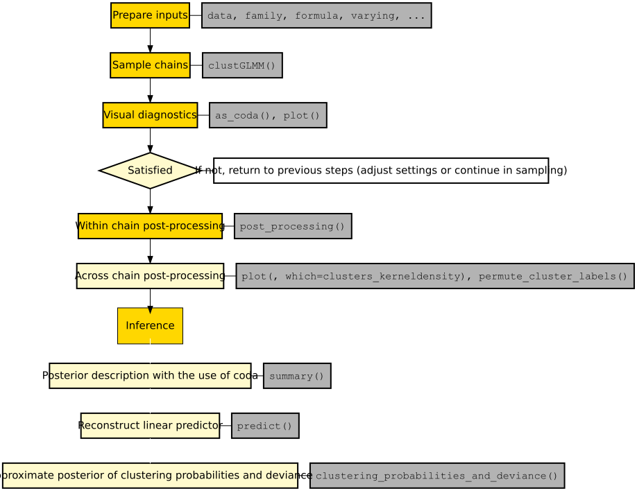

<!--
output:
  rjtools::rjournal_pdf_article:
    self_contained: yes
    toc: no
always_allow_html: true
-->

```{r setup, include=FALSE}
knitr::opts_chunk$set(echo = FALSE, warning = FALSE, message = FALSE, fig.path = "figure-latex/")
options(tinytex.verbose = TRUE, width = 90, digits = 4)
# options(width = 110) # does not change the template
library("kableExtra")
library("clustGLMM")

combine <- function(x, sep, width) {
  cs <- cumsum(nchar(x))
  remaining <- if (any(cs[-1] > width)) combine(x[c(FALSE, cs[-1] > width)], sep, width)
  c(paste(x[c(TRUE, cs[-1] <= width)], collapse= sep), remaining)
}
prettyPrint <- function(x, sep = " ", linebreak = "\n\t", width = getOption("width")) {
  x <- strsplit(x, sep)[[1]]
  paste(combine(x, sep, width), collapse = paste(sep, linebreak, collapse = ""))
}  
```

The supplementary materials provide more information on the prior
settings including the hyperparameter values to complete the model
specification in 
`r if (knitr::is_html_output()) "[the Priors section](#priors)" else "Section \\ref{priors}"`, 
the implementation in the R package in 
`r if (knitr::is_html_output()) "[the Implementation section](#implementation)" else "Section \\ref{implementation}"`, 
and the back transformation of the parameters in case of
standardization in 
`r if (knitr::is_html_output()) "[the Back transformation after standardization section](#standardize-back)" else "Section \\ref{standardize-back}"`.

# Priors {#priors}

We summarize our choices for the prior distributions in Table
\@ref(tab:prior-table). This table also includes the default choices
for the hyperparameters and indicates the names used in the
\pkg{clustGLMM} package.

```{r prior-table, tab.cap = "Overview of prior distributions and their hyperparameters including the default values."}
ptab <- data.frame(Notation = c("$\\beta_{lr}^F$, $\\beta_{lr}^{(g)}$",
                                "$\\tau_r$",
                                "$\\beta_{lr}^F$, $\\beta_{lr}^{(g)}$",
                                "$\\mathbf{c}_r$",
                                "$\\mathbf{b}_i$",
                                "$\\boldsymbol{\\Sigma}^{-1}$",
                                "$\\mathbb{Q}^{-1}$",
                                "$w_g$", 
                                "$e_0$"), 
                   Distribution = c("$\\mathsf{N}(0,\\tau_r^{-1} s_{\\mathsf{Num}}^2)$", 
                                    "$\\Gamma(a_\\tau,b_\\tau)$",
                                    "$\\mathsf{N}(0,s_r^2)$", 
                                    "transformed $\\mathsf{Dir}(\\alpha)$",
                                    "$\\mathsf{N}_{d^R}(0,\\boldsymbol{\\Sigma})$",
                                    "$\\mathsf{W}_{d^R}(\\nu_0+d^R, \\mathbb{Q})$",
                                    "$\\mathsf{W}_{d^R}(\\nu_1+d^R, v\\mathbb{I})$",
                                    "$\\mathsf{Dir}(e_0)$",
                                    "$\\Gamma(a_e,b_e)$"), 
                   Hyperparameter = c("$s_{\\mathsf{Num}} = 1$",
                                      "$a_\\tau = 1$, $b_\\tau = 10$",
                                      "$s_{r} = 1$",
                                      "$\\alpha = 1$",
                                      "",
                                      "$\\nu_0=1$",
                                      "$\\nu_1=1$, $v=100$",
                                      "",
                                      "$a_e = 1, b_e = 100$"),
                   `\\pkg{clustGLMM} name` = c("$\\mathtt{beta\\_num\\_fix\\_sd}$, $\\mathtt{beta\\_num\\_sd}$",
                                 "$\\mathtt{prec\\_num\\_shp}$, $\\mathtt{prec\\_num\\_rte}$",
                                 "$\\mathtt{beta\\_type\\_fix\\_sd}$, $\\mathtt{beta\\_type\\_sd}$",
                                 "$\\mathtt{api\\_prior}$",
                                 "",
                                 "$\\mathtt{InvSigma\\_df}$",
                                 "$\\mathtt{InvQ\\_df}$, $\\mathtt{InvV}$",
                                 "",
                                 "$\\mathtt{e0\\_shp}$, $\\mathtt{e0\\_rte}$"),
                   Note = c("or with $\\tau_r^{(g)}$, for conjugacy",
                            "or for $\\tau_r^{(g)}$",
                            "$s_r$ specific to type not each outcome",
                            "for $\\pi_{r,k}^{(g)} = \\mathsf{logit}^{-1}(c_{r,k-1}^{(g)}) - \\mathsf{logit}^{-1}(c_{r,k}^{(g)})$",
                            "or with $\\boldsymbol{\\Sigma}^{(g)}$",
                            "or for $\\boldsymbol{\\Sigma}^{-(g)} := \\left(\\boldsymbol{\\Sigma}^{(g)}\\right)^{-1}$",
                            "or for $\\mathbb{Q}^{-(g)} := \\left(\\mathbb{Q}^{(g)}\\right)^{-1}$",
                            "symmetric, $e_0$ randomized",
                            "sparse finite mixture with $a_e/b_e$ low"),
                   row.names = c("Fixed effects ($\\mathsf{Num}$)", 
                                 "Error precision",
                                 "Fixed effects (other)", 
                                 "Ordered intercepts",
                                 "Random effects", 
                                 "Precision matrix",
                                 "Inverse scale matrix",
                                 "Component sizes",
                                 "Sparsity"),
                   check.names = FALSE)
kable(ptab, booktabs = TRUE, escape = FALSE) |> kableExtra::landscape()
```

# Implementation {#implementation}

In the following, we discuss the implementation of the methodology
in package \pkg{clustGLMM} in more detail. An overview of the typical workflow and
the key functions is given in Figure\ \@ref(fig:workflow-diagram). In
the following subsections we go through each of the steps and discuss
it in detail.

```{r workflow-diagram, fig.cap="Typical workflow with \\pkg{clustGLMM} and key functions.", out.width="100%", dev="png"}
graph <- DiagrammeR::grViz("digraph {
  graph[layout = dot, rankdir = TB]
  
  node[shape = rectangle, style = rounded, fontname = Helvetica, penwidth = 2, fontsize = 15, fillcolor = gold, style = filled]  
  rec1[label = '@@1']
  rec2[label = '@@2']
  rec3[label = 'Visual diagnostics']
  rec3a[label = 'Satisfied', shape = diamond, fillcolor = LemonChiffon, style = filled]
  rec4[label = 'Within chain post-processing']
  rec5[label = 'Across chain post-processing', fillcolor = LemonChiffon]
  
  node[shape = rectangle, style = rounded, fontname = courier, penwidth = 2, fillcolor = grey70, style = filled] 
  code1[label = 'data, family, formula, varying, ...']
  code2[label = 'clustGLMM()']
  code3[label = 'as_coda(), plot()']
  code3a[label = 'If not, return to previous steps (adjust settings or continue in sampling)', fillcolor = white, fontname = Helvetica]
  code4[label = 'post_processing()']
  code5[label = 'plot(, which=clusters_kerneldensity), permute_cluster_labels()']
  
  node[shape = rectangle, style = rounded, fontname = courier, penwidth = 2, fillcolor = grey70, style = filled]
  code6a[label = 'summary()']
  code6b[label = 'predict()']
  code6c[label = 'clustering_probabilities_and_deviance()']
  
  subgraph cluster6 {
    graph[layout = fdp, shape = rectangle, style = rounded, fillcolor = gold, style = filled]
    
    label = ''
    node[shape = rectangle, style = rounded, fontname = Helvetica, penwidth = 2, fillcolor = LemonChiffon, style = filled]
    rec6[label = 'Inference', fillcolor = gold, shape = none]
    rec6a[label = 'Posterior description with the use of coda']
    rec6b[label = 'Reconstruct linear predictor']
    rec6c[label = 'Approximate posterior of clustering probabilities and deviance']
  }
  
  # edge definitions with the node IDs
  edge[arrowhead = normal, arrowtail = none]
  rec1 -> rec2 -> rec3 -> rec3a -> rec4 -> rec5 -> rec6
  
  edge[arrowhead = none, arrowtail = none]
  {{rank=same rec1 -> code1}}
  {{rank=same rec2 -> code2}}
  {{rank=same rec3 -> code3}}
  {{rank=same rec3a -> code3a}}
  {{rank=same rec4 -> code4}}
  {{rank=same rec5 -> code5}}
  {{rank=same rec6a -> code6a}}
  {{rank=same rec6b -> code6b}}
  {{rank=same rec6c -> code6c}}
  
  edge[arrowhead = normal, arrowtail = none, color = white, maxlen=1]
  rec6 -> rec6a -> rec6b -> rec6c 
  
  }
  
  # Substitutions with R code are possible:
  [1]: paste0('Prepare inputs')
  [2]: paste0('Sample chains')
  ",
  height = 500, width = 600)
svg_text <- DiagrammeRsvg::export_svg(graph)
rsvg::rsvg_png(charToRaw(svg_text), file = "workflow-diagram.png")

```

## Prepare inputs {#impl-prepare-inputs}

First, we discuss the arguments which need to be specified for the main fitting function `clustGLMM()` and describe the expected format of the required inputs. The overview of the arguments of function `clustGLMM()` reads:

```{r}
cat(prettyPrint(prompt(clustGLMM::clustGLMM, 
                       filename = NA)$usage[[2]], sep = ", ", 
                linebreak = paste("\n", paste(rep(" ", 2), collapse = ""), sep= ""),
                width = 60))
```

The outcomes with their types, i.e., their distributions, are specified in the `family` argument. This argument is provided as a\ named vector indicating the outcome types named by the outcome names matching the column name in `data`. The following types are available:

* `"num"`, `"gaussian"` for numeric outcomes, $r\in\mathcal{R}^{\mathsf{Num}}$,
* `"poi"`, `"poisson"` for count outcomes, $r\in\mathcal{R}^{\mathsf{Poi}}$,
* `"bin"`, `"bernoulli"` for binary outcomes, $r\in\mathcal{R}^{\mathsf{Bin}}$,
* `"ord"`, `"cumulative"` for ordinal outcomes, $r\in\mathcal{R}^{\mathsf{Ord}}$,
* `"cat"`, `"categorical"` for categorical outcomes, $r\in\mathcal{R}^{\mathsf{Cat}}$, where the first category is considered the baseline.

Internally, outcomes are ordered to ensure that the types are in the same order as listed above. <!-- Ensuring this ordering eases the estimation of the covariance matrix $\boldsymbol{\Sigma}$. --> The `family` returned by `clustGLMM()` then follows this ordering.

Our implementation allows a\ different model formula for each outcome. All formulas are passed in the argument `formula` as a\ named list with names indicating the outcomes. For each outcome, three formulas (of class `"formula"`) are required:

* `fixed` for fixed effects common to all clusters,
* `group` for cluster-specific fixed effects,
* `random` for `id`-specific random effects.

In addition there is also the option to include an element named `offset` which contains the column name of the offset variable, i.e., the values that shift the linear predictor without any unknown coefficient. By default, no `offset` is considered. Sharing the same terms in both, the `fixed` and `group`, formulas is allowed. By default, this is resolved by removing duplicated terms from `fixed` and having them only included in the model matrix corresponding to the `group` formula. For example, if both formulas imply that an intercept is included in the model matrix, a\ cluster-specific intercept is estimated. Note that the intercept term is removed from the formula for ordinal outcomes, since this is captured by the model parameter `c_ord` (or its transformations `a_ord` or `pi_ord`). The `"clustglmm"` object returned by `clustGLMM()` contains lists (`lfixnames`, `lgrpnames`, `lrannames`) of covariate names which can be matched to the corresponding regression coefficients `beta...[]` or random effects `b[,]`.

Data are passed in the `data` argument as a\ `data.frame` which contains all outcomes, regressors and a\ column with name specified in the argument `id` that indicates which rows correspond to the same subject. The values in `id` are internally mapped to `1:n` where `n` is the number of unique values in `id`. This mapping is returned in the `"clustglmm"` object as element `numbered_unique_ids`. The maximum number of components to include in the mixture model is specified as an integer value with the argument `G` (allowing also the value 1 to induce no clustering).

The next four arguments provide more details regarding the model specification, the model estimation via MCMC sampling as well as how sampling results are returned. These arguments are expected to have the following structure: 

* `varying` - a\ named vector of Booleans controlling cluster-specificity of other model parameters, 
* `save` - a\ named vector of Booleans controlling which sampled model parameters should be returned, 
* `param` - a\ named list of prior hyperparameters, 
* `tuning` - a\ named list with named lists for integer and double values that adjust the sampler, especially the M-H proposal steps constructed by the use of the N-R method. 

For a\ full description of each argument see the documentation. If an argument is missing, then the default choices constructed by `default_varying()`, `default_save()`, `default_param()`, and `default_tuning()` are used. We recommend to call these functions, change the default object returned as required and use the updated object in the call to `clustGLMM()`.

The argument `inits` expects a\ list of initial values used to start each of the chains. The structure is the same as the output `last` of `clustGLMM()`. The output `last` can be used to easily continue sampling. It suffices to call `clustGLMM()` with the same settings and specify `inits = ...$last`. Note that if standardization is in effect, these initial values relate to the transformed scale and not the original one, which is used for the returned samples. If the argument `inits` is missing, then initial values are determined in an automatic way based on a\ random partition of the observations for each chain. 

It remains to choose the number of chains using `nchains` (chains will be labeled by `1:nchains`, with `G` allowed to vary across chains through specification via an integer vector), the length of the chains to be sampled with `iter` and the standardization indicator `standardize`. The last argument specifies the format in which the samples should be returned via `howsave`. We recommend to use the option `"data.fame"` which implies that for each chain, all model parameters are returned in one huge data frame with carefully named columns based on the following pseudocode:

```{r matrix-column-name, eval = FALSE, include = TRUE, echo = TRUE}
paste0(parameter, # parameter ~ character(1)
       if (is.outcome.specific) {"_", outcome}, # outcome ~ character(1)
       if (is.group.specific) {"(", g, ")")}, # g ~ integer(1)
       if (is.not.0D) {"[", d[1], if(is.2D) {",", d[2]}, "]"} # d ~ integer(2)
) # e.g., "beta_num_income(1)[1]"
```

This means that the naming convention indicates that first the
parameter name and outcome type are given (e.g., `"beta"` and `"num"`)
separated by `"_"` and followed by the outcome name (e.g., `"income"`)
also separated by `"_"`. Then the component number in round
brackets is included (e.g., `"(1)"`) and the dimension by square
brackets (e.g., `"[1]"`).

Alternatively, we also provide a\ second option corresponding to
`"list"`. Using this option, all sampled values are saved in a
carefully structured list with the following layers: chain, parameter
name, outcome name (for outcome-specific parameters), cluster (for
cluster-specific parameters). The leaves of this structure are arrays
(2D or 3D) depending on the subset of parameters.

## Sample chains {#impl-sample-chains}

After careful preparation of all inputs, `clustGLMM()` can safely be
called to samples the MCMC chains. In this section we describe each of
the steps this function performs.

First, missing arguments are replaced with their default values. A\ warning is issued in case argument `save` specified that crucial parameters are not to be returned. Subject indices `id` are relabeled and outcomes are suitably ordered. Then, each outcome is checked for compatibility with its given type:

* `num` - values have to be numeric, infinite values are not allowed, otherwise an error occurs. If `standardize = TRUE`, `scale()` is applied with `center` and `scale` determined by `mean` and `sd` while ignoring missing values.
* `poi` - values are checked to be finite non-negative integers, otherwise an error occurs.
* `bin` - `factor()` is applied and an error occurs if the number of unique values is not 2. Internally, the first level is considered to be 0, the other 1.
* `ord` - if not yet of class `"ordered"`, `factor(., ordered = TRUE)` is called. Internally, the ordered categories are replaced with 0, 1, ..., `Kord`.
* `cat` - if not yet of class `"factor"`, `factor()` is called. Internally, the ordered categories are replaced with 0 (baseline), 1, ..., `Kcat`.

Ordinal and categorical outcomes are not allowed to have less than 3 levels (as for 2 levels one may use the binary type), but there is no upper limit for the number of categories. As the number of parameters grows with the levels, the user needs to take care not to specify a\ variable with many unique values to be a\ categorical outcome. Note that `Kord` and `Kcat` correspond to the actual number of categories minus 1 (as the numbering starts at 0).

Next, the `formula` is processed and model matrices are created. All model matrices are combined into one large model matrix with uniquely named columns. This is computationally more efficient because we expect many columns to be simultaneously  used for several outcomes. For each outcome, a\ list of the column names that result from the `fixed`, `group` and `random` formulas is created to select the suitable columns from the full model matrix (`lfixnames`, `lgrpnames`, `lrannames`). These lists also determine the order in which the effects are named and saved. For example, `"[1]"` in `"beta_num_income(1)[1]"` indicates that this cluster-specific regression coefficient is tied to the first element of the corresponding `lgrpnames[["income"]]` value. During these preparations, we ensure that not the columns are included in `fixed` and `group` and eliminate the column names common to `fixed` and `group` from `fixed` and keep them only in `group`.

If `standardize = TRUE`, the ability to transform parameters back to the original scale is checked. An error is triggered if the intercept term (column `"(Intercept)"`) does not appear among the `fixed` and `group` effects. In case of group-specific effects, the `group` formula is ensured to include an intercept. An ordinal outcome has no explicit intercept within the formula, but the parameter of the ordered intercepts needs to be group-specific (`varying["c_ord"] = TRUE`) if there are some group-specific effects. In case of standardization, random effects have to include an intercept and, otherwise, an error is triggered. The scaling of columns other than `"id"` or `"(Intercept)"` is performed with `scale(, center = TRUE, scale = TRUE)`. The centers and scales used are saved in named vectors `centers` and `scales`.
Finally, note that `NA` values for regressors are not allowed.

Next, initial values are determined if the argument `inits` is missing. First, a\ random partition of observations into the given number of components `G` is created. Then, for each outcome, the corresponding model (`lm`, `glm(family = poisson)`, `glm(family = binomial)`, `MASS::polr`, `nnet::multinom`) is fitted with common effects for the fixed and group-specific effects and all available data. The estimates corresponding to fixed effects are used as their initial values. Then, the same model is fitted on each subset of data from the random partition to obtain the initial values for the group-specific regression coefficients. If an error occurs, e.g., due to small group size in the partition, then the estimates from the fit with the complete data are used instead. The random effects are sampled randomly from a\ centered normal distribution with standard deviation given by `param$init_b_sd`. The precision matrix for the random effects is initialized randomly as a\ diagonal matrix with diagonal elements sampled from a\ gamma distribution with shape `1/param$init_b_sd^2` and unit rate.

The model contains a\ lot of parameters of very different nature (outcome-specific, group-specific, varying dimension). In order to cope with these differences, a\ matrix `settings` is created for each chain where each row contains all necessary information to properly handle one of the model parameters. Since the number of components could be different for different chains, a\ list of such matrices for each chain is returned. The most important columns of this matrix provide information on the dimension size (with or without group-specificity). This information is crucial to store the sampled values of the parameters. For outcome-specific parameters (e.g., regression coefficients), the lists `yspecd1` and `yspecd2` contain the total dimension sizes per each outcome.

The MCMC sampling is by far the most time-consuming part of this function. The pure R implementation was painfully slow and, therefore, C routines were implemented to do the heavy lifting. This requires additional preparation steps, since only vectors of integers or doubles can be passed down via `.C()`. During this preparation, for example, IDs and cluster allocation indicators are shifted to start from 0 and not 1, the labels for the categorical outcomes of the first and last category are switched (as the C functions assume the last category to be the baseline), `NA` values are replaced with zeros. Moreover, the initial values are concatenated in the order expected by the C function. These values are duplicated into a\ vector of the same length representing the current parameter values. Both vectors are accompanied by a\ structure of pointers pointing to the starts of each of the parameters. When a\ new value of the parameter is sampled (and accepted), the corresponding cells are overwritten. Simultaneously, these new values are saved into storage vectors which were prepared separately for each model parameter including also the transformed ones (standard deviations, correlations, ...). The C code regularly prints the percentage of sampled iterations so that the user may estimate the remaining time to finish the sampling step. After the sampling, the vector containing the last values is transformed back into the R format. In this way, the last sampled values `$last` can be used again as initial values. Depending on the save format indicated in `howsave`, the stored values are processed into the final `$draws` output with the help of `from_C_to_...` functions. If standardization was applied, then the `$draws` (but not `$last`) are transformed back to enable the interpretation on the original scale. The details about this back-transformation are given in `r if (knitr::is_html_output()) "[the Back transformation after standardization section](#standardize-back)" else "Section \\ref{standardize-back}"`.

This sampling is performed sequentially for all chains. In case this is very time-consuming, parallelization across chains might be attempted. This can be achieved by writing a\ function that calls `clustGLMM()` with the same settings for `nchains = 1` in parallel and then combines the results into one object. In addition, high memory demands might be caused, not only by the vast number of parameters of large dimension sizes but also due to auxiliary variables. For example, the C functions use a\ 4-component predictor dedicated to the fixed, group, random and offset part, and the final predictor is the sum of these four components. When some of the effects are updated, only the corresponding part of the predictor gets updated and the rest remains untouched. This approach is even more expensive for categorical outcomes where a\ separate predictor is kept for every non-baseline category. To reduce the memory demands, all operations with symmetric matrices are handled using only the upper triangle.

Another potential source for long sampling times could be due to difficulty when determining a\ suitable proposal distribution via the N-R method initiated with the last known value. In case the N-R method does not converge or does not meet the required tolerance `tuning$double$tolerance` after the maximal number of steps `tuning$integer$maxiter`, the N-R procedure is started again from a\ different point (corresponding to the current best approximation scaled by a\ value uniformly sampled from $(0, 1)$). This is repeated until the required tolerance is met or the maximal number of N-R reiterations `tuning$integer$maxnrep` is reached. If the N-R method is not successfully terminated, the current best solution is used for the proposal distribution. Since this search for an optimal proposal distribution can be very time-consuming, the proposal distributions are updated only every `tuning$integer$freq_proposal_update`-th iteration. Since the acceptance rate could be very low, there is also an option to repeat the proposal step for the same parameters several times with `tuning$integer$times_proposal > 1`. Faster computation times could be achieved by adjusting these tuning parameters. However, a\ faster evaluation could also come at the cost of lower acceptance rates. We recommend to update the proposal distribution frequently when the stationary distribution has not been reached yet. The proposal distribution is scaled by `tuning$double$const_proposal_...` where `...` stands for any parameter updated via the M-H proposal. Similar to the prior hyperparameters, their value is fixed for every underlying parameter, e.g., one cannot set different values for two outcomes of the same type.

Latent variables and model parameters are sampled in the following order (using either a\ Gibbs or M-H sampling step):

* `naY` - missing outcome values are generated from the underlying model given the current allocation of the corresponding individual. These replace the `NA` values in the vector used for storing the outcome values. It is also possible to sample the potential outcome values if the individual had been in other clusters by setting `varying["naY"]` to `TRUE`.
* `beta_num`, `beta_num_fix` - regression coefficients for numeric outcomes (Gibbs).
* `prec_num` - precision error term for numeric outcomes and its transformation to standard deviation `sd_num` and variance `var_num` (Gibbs).
* `beta_poi`, `beta_poi_fix` - regression coefficients for count outcomes (M-H).
* `beta_bin`, `beta_bin_fix` - regression coefficients for binary outcomes (M-H).
* `beta_ord`, `beta_ord_fix` - regression coefficients for ordinal outcomes (M-H).
* `a_ord` - ordered intercepts transformed into the unrestricted space (M-H), then transformed back to the original and prior interpretation `c_ord`, `pi_ord`.
* `beta_cat`, `beta_cat_fix` - regression coefficients for categorical outcomes (M-H).
* `InvSigma` - precision matrix for random effects (Gibbs) and its transformations: covariance matrix `Sigma`, standard deviations from diagonal `sdSigma`, correlation matrix `corSigma` and determinant `detInvSigma`.
* `InvQ` - inverse of the Wishart scaling matrix for the prior for `InvSigma` (Gibbs) and its transformations `Q` and determinant `detInvQ`.
* `b` - random effects (M-H). 
* `w` - component weights (Gibbs).
* `pUig` - full-conditional clustering probabilities and then the new allocation indicators `U`. As by-product we obtain the cluster occupancy numbers `ng` and the number of non-empty clusters `Gplus`. In this step, also `loglik` is determined, which corresponds to the "in-sample log-likelihood". In particular, to obtain the log-likelihood value, integration over latent variables (i.e., the allocation indicators and random effects) is not performed and the last sampled values are inserted. 
* `e0` - Dirichlet parameter sampled on the log-scale and then transformed back (M-H). 

Note that the steps for `InvSigma`, `InvQ` and random effects are dropped if there are no random effects. In such a\ case the outcomes as well as the observations (rows) for the same ID are assumed to be independent. This allows to also fit regular cluster-wise regressions without including random effects. 

Before all the outputs of `clustGLMM()` are returned in a\ list, a\ crude clustering is performed for each chain separately which does not account for potential label switching. First, the sampled allocation indicators `U` (with values in 1, ..., G) are summarized for each individual. The matrix `clustering` then contains the most frequent cluster label for each individual in the rows and each chain in the columns. The matrix `certainty` then contains the proportion of these most frequent labels for each individual and chain. Then, the most frequent number of non-empty components `modeGplus` is determined for each chain. A list `clusters` then contains for each chain the `modeGplus` labels included in `clustering`. These labels will be used for plotting. The other components are considered empty and ignored for plotting, unless specified otherwise.

Finally, `call` summarizes the sample sizes as well as the formulas specified for all outcomes: first, the fixed effects, then the random effects (in the order assumed by `InvSigma`) and finally the group-specific effects. Printing objects of class `"clustglmm"` prints the content of `call` followed by the summary of the crude clustering for each chain separately.

## Visual diagnostics {#impl-visual-diagnostics}

Given that some users may already be familiar with already established diagnostic tools for assessing convergence of a\ MCMC chain, we provide function `as_coda()` to convert an object of class `"clustglmm"` to a\ `"mcmc.list"` object as defined in package \CRANpkg{coda} [@Plummer06coda]. This enables easy use of all diagnostic tools available in that package.

The use of these tools, however, might be complicated by the large dimension of the parameter space of our model, which can easily contain hundreds of parameters and even thousands of values in case latent id-specific variables are also considered. We thus provide a\ set of plotting functions which provide diagnostic plots for selected specific individual parameters related to a\ given parameter name:

* `plot_ACF_param` - plots the auto-correlation function (ACF), use `plot_ACF` for a\ single scalar parameter choice.
* `plot_ECDF_param` - plots the empirical cumulative distribution function (ECDF), use `plot_ECDF` for a\ single scalar parameter choice.
* `plot_kerneldensity_param` - plots the kernel density estimate, use `plot_kerneldensity` for a\ single scalar parameter choice.
* `plot_traceplots_param` - provides trace plots (value vs. iteration), use `plot_traceplots` for a\ single scalar parameter choice.
* `plot_clusters_ECDF_param` - compares cluster-specific parameters across (non-empty) clusters via ECDF, use `plot_clusters` for a\ single scalar parameter choice. 
* `plot_clusters_kerneldensity_param` - compares cluster-specific parameters across (non-empty) clusters via kernel density estimates, use `plot_clusters` for a\ single scalar parameter choice. 

These functions are wrapped by the `plot` method for `"clustglmm"` objects that covers all of these options. The trace plots of total cluster occupation numbers `ng` are shown by default. Based on these plots, the burn-in period for dropping of samples, a\ suitable thinning of the samples as well as even a\ set of suitable iterations may be selected. The plots are automatically organized into a\ matrix of convenient sizes by setting `par(mfrow = ...)`. This can be prevented by setting `setparmfrow = FALSE`. 

By default, `plot(mcmc)` produces trace plots of the cluster occupancy numbers with the use of `plot_ng_trace_chain_split()` where separate plots are created for each chain and each plot contains the trace plots for all clusters within one chain. This default plot allows to easily identify which clusters are empty (or in the process of emptying). 
For all other specifications, the  `plot` method for `"clustglmm"` objects plots all chains together into one plot but using only a\ single model parameter. If this is also desired for `what = "ng"`, set `ng_trace_chain_split = FALSE`. <!-- In addition, the `plot` method is also able to arrange plots for parameters of the same purpose, e.g., all regression coefficients for certain type of outcome. -->

In case a\ univariate parameter is of interest, `plot_diagnostics()` displays the four plots consisting of ACF, ECDF, kernel density and trace plot on a\ $2 \times 2$ grid. To select the univariate parameter properly, one needs to provide (if applicable) `what` (the name of the parameter), `yspec` (to which outcome it belongs), `gspec` (to which group it corresponds) and `dimspec` (the specific dimension). The `settings` matrix provides the information on what has to be supplied for which parameter. There is also the possibility to include a\ line in the plot indicating the true value of the parameter, if known. 
Table \@ref(tab:settings-table) summarizes the key parameter attributes.

```{r get-some-mcmc, echo = FALSE, results = FALSE, eval = TRUE, message = FALSE}
data("longitudinal_mixed_type_data")
id <- "i"

family <- c("num", "poi", "bin", "ord", "cat")
names(family) <- Ys <- c("ynum", "ypoi", "ybin", "yord", "ycat")

## Create list of formulae for each outcome
formula <- list()
for(y in Ys){
  formula[[y]] <- list()
  formula[[y]]$fixed <- ~ f
  formula[[y]]$group <- ~ x
  formula[[y]]$random <- ~ 1
  formula[[y]]$offset <- ""
}

Gmax <- 5     # maximal number of mixture components to be considered
nchains <- 2  # number of chains to be sampled 

## No inits specified
set.seed(123456789)
mcmc <- clustGLMM(formula = formula, id = id, family = family, 
                  data = longitudinal_mixed_type_data, 
                  G = Gmax, iter = 10, nchains = nchains)
```


```{r settings-table, echo = FALSE, tab.cap = "Information on the model parameters stored in \\texttt{settings}: D = 0 indicates scalar, D = 1 vector, D = 2 matrix. g indicates group-specificity (? depends on choice). y indicates if specific to an outcome. yd1, yd2 indicates if specific to an outcome in the first or second dimension. N, P, B, O, C indicate the outcome type. sym indicates whether the matrix is symmetric and diag whether it contains the diagonal. "}
m <-mcmc$settings[[1]][c("D", "gspec", "isy", "ydepd1", "ydepd2", "ynums", "ypois", "ybins", "yords", "ycats", "sym", "diag")]
m[c("prec_num", "var_num", "sd_num", "c_ord", "a_ord", "pi_ord", "InvSigma", "Sigma", "sdSigma", "corSigma", "detInvSigma", "InvQ", "Q", "detInvQ", "naY"), "gspec"] <- "?"
for(col in c("gspec", "isy", "ydepd1", "ydepd2", "ynums", "ypois", "ybins", "yords", "ycats", "sym", "diag")){
  m[m[,col] == TRUE, col] <- "T"
  m[m[,col] == FALSE, col] <- "F"
}
colnames(m) <- c("D", "g", "y", "yd1", "yd2", "N", "P", "B", "O", "C", "sym", "diag")
kable(m, booktabs = TRUE)
```

If the visual diagnostic tools suggest that the MCMC sampling has not converged to the stationary distribution yet, sampling can be continued by calling `clustGLMM()` with the same input arguments and `inits = ...$last`. If the results seem not suitable, for example, from a\ clustering perspective, it could be helpful to adjust the input arguments or start sampling with a\ different seed. 

## Within-chain post-processing {#impl-post-processing}

In case of a\ clear clustering structure in the data and suitable model specification, one potentially may  skip this step. Otherwise, this step is necessary to resolve issues due to iterations recorded during sampling where the numbers of non-empty components differed within one chain or due to the meaning of the labels being ambiguous because of label switching between iterations. Function `post_processing()` allows to address these issues by implementing suggestions by @FruhwirthSchnatter11 and @Malsiner-Walli-etal2026clips. The function retains only iterations where the number of non-empty components corresponds to the most common number of non-empty components `Gplus` saved as `modeGplus` in the `"clustglmm"` object and resolves label-switching to enable inference about cluster-specific parameters to be based on an identified model. 

The function implements the following steps for each chain separately:

0. If sampling results are saved in format `"list"`, convert them to format `"data.frame"` and then back after the last step. This function requires format `"data.frame"`.
1. Take the most frequent `Gplus` value - `modeGplus` - for the number of non-empty components across the sampled chain and retain only iterations where `Gplus = modeGplus`. <!-- The indices are stored in `inds` and their length is `iters`. -->
2. Select all cluster-specific parameters with the exception of `w`, `U`, `pUig`, unless specific columns to be used with `kmeans()` are indicated.
3. Gather the cluster-specific parameters from non-empty components for each retained iteration. Each parameter will have `modeGplus` values.
4. Stack the values for the same parameter into one long column for every considered cluster-specific parameter, resulting in a\ tall matrix where the number of rows correspond to the number of iterations retained times `modeGplus`. 
5. Apply $K$-means clustering using `kmeans()` to the matrix from 4. with `centers = modeGplus`, and `iter.max = 200` and `nstart = 30` as default options. Ideally, rows corresponding to the same iteration are assigned to different centroids in the $K$-means clustering solution. In this case, values are permuted accordingly. If all rows for one iteration are not assigned to `modeGplus` different clusters, then this iteration is eliminated. In particular, values for cluster-specific parameters are replaced with `NA`. The summary of `post_processing()` informs about the percentage of iterations removed.
6. Apply the same permutations to the rest of the group-specific parameters and transform the parameters back to the wide format for the iterations retained.
7. Create the data frame of posterior draws by joining cluster-invariant samples, permuted (and aligned) group-specific and clustering-related parameters.
8. Update all other items of the `"clustglmm"` object, accordingly, including in particular `clustering`, `certainty`, `G` (now `modeGplus`, possibly different among chains), `last`, `call` (summary of the post-processing) and many others.

The return value of this post-processing step is again of class `"clustglmm"` and all plotting functions should still work with the reduced set of iterations. 

## Across-chain post-processing {#impl-permute-cluster-labels}

Even though label switching has been resolved in the previous step for each chain, the interpretation of the labels may still not match across multiple chains. This is one of the drawbacks of random initialization and not fixing the meaning of the clusters a-priori. <!-- One way to deal with it would be to take favorite chain and use its `last` state as initial value for every other chain and continue in sampling. -->  To resolve the label switching across chains, we provide function `permute_cluster_labels()`. The user can supply a\ list of permutations `perm` (one for each chain) and all quantities with a\ clustering index in the given `"clustglmm"` object are permuted. Suitable permutations could for example be determined by inspecting the plots for cluster-specific parameters across chains. If, however, the `perm` argument is not specified, the Hungarian algorithm is used to align cluster labels of all chains with the first chain. The cost matrix for the Hungarian algorithm is determined based on the root mean square error between cluster-specific parameters.

Once the cluster labels are aligned across chains, inference may be based on the sampled values from all chains similarly to the usual behavior in the \pkg{coda} package. In some cases, such an alignment may not be possible, e.g.,  when the number of non-empty components does not match across chains. We recommend to then proceed performing inference for each chain separately, potentially focusing on the chain providing the most reasonable and the best interpretable results. 

## Inference {#impl-inference}

### Posterior description {#impl-summary}

A first basic posterior exploration may be performed using the `summary` method for objects of class `"clustglmm"`. The outputs are obtained using the `summary` method for `"mcmc"` object with `na.rm = TRUE` after transforming the `"clustglmm"` object with `as_coda` for each chain separately. The `print` method automatically prints a\ `quantiles` table and the posterior mean from `statistics` for all chains contained in `$chains`, unless specified differently. Since the list of model parameters can be long, we divided them into several groups: cluster-invariant parameters (`"inv_param"`), clustering-related parameters (`"clust_param"`, i.e., `Gplus`, `e0` and the component sizes), latent variables (`"latent_param"`) and group-specific parameters (`"group_param"`, i.e., the cluster-specific regression coefficients). Users can specify the groups of parameters which should be printed via argument `which`. Argument `which` may specify several groups and also include `"mcmc"` (to obtain a\ chain overview) and `"clustering"` (to obtain a\ clustering overview). The summary of the clustering is based on `clustering` and `certainty` in the `"clustglmm"` object where all subjects are classified into the cluster with the highest certainty. In addition, the posterior distribution of the model parameters can also be explored visually using the `plot` method.  <!-- If some subjects should remain unclassified (label 0) due to insufficient certainty level, this has to be done manually by the user. -->

We also provide functions for plotting the outcomes against one of the continuous covariates: `plot_num_vs_x_grouped()` and `plot_cat_vs_x_grouped()`. The argument `group` specifies the name of a\ column in `data` which partitions the subjects into groups, e.g., the resulting clustering. Every cluster is plotted with one of the colors obtained with `colorspace::rainbow_hcl()` with the color slate-grey being reserved for label 0 (unclassified). 

With `plot_num_vs_x_grouped` the relationship of outcome and continuous covariate `x` is depicted by spaghetti plots. Observations corresponding to the same subject (i.e., having the same ID) are joined with thin segments (ordered by the $x$-axis covariate `x`). A thick line of darker color shade then corresponds to the `loess.smooth` curve. Since the clusters can overlap, we recommend to plot subsets of the data separately for better visualization. If `x` is a\ factor, then overlapping boxplots with transparent colors are plotted for each level and group. 

<!-- TODO - think about implementing of plots only for subset of groups instead of all of them (default).-->

With `plot_cat_vs_x_grouped` the relationship of a\ factor outcome and a\ continuous covariate `x` is depicted by spineplots. For each cluster separately, stacked proportions of outcome labels are plotted for categories of `x` determined by `xbreaks`. By default, `x` is categorized using 11 equidistant points from minimum to maximum as breaks. If `x` is already a\ factor, then the spineplot is created using this categorization. 


### Linear predictor {#impl-predict}

Function `plot_num_vs_x_grouped()` plots loess curves which are quick and easy to plot, yet do not represent the posterior estimates. Therefore, we also provide a\ `predict` method for `"clustglmm"` objects that constructs the linear predictor for given `newdata`. For example, the majority of covariates could be fixed at specific values and the remaining covariates may be systematically varied on a\ grid and then the `predict` method used to capture their effect. 

Two methods are implemented to obtain a\ posterior linear predictor point estimate. The plug-in method takes the posterior point estimates of the regression coefficients and computes the corresponding linear combinations yielding a\ point estimate of the same type. The other method takes the posterior samples of the regression coefficients and computes linear combinations for all iterations. In this way, samples to approximate the full posterior are obtained, and, for example, credible intervals (for individual points, not the whole curve) could be computed.

### Clustering probabilities and deviance {#impl-clust-prob-deviance}

After MCMC sampling, estimates of the posterior probabilities for an observation to be assigned to each of the clusters might be obtained based on the sampled allocation indicators. In some cases, these estimates could be rather crude. An alternative approach, which potentially results in better estimates, builds on the fact that the posterior probability of a\ subject to belong to one of the clusters could be determined directly for specific parameter values, in case one integrates over the random effects. Function `clustering_probabilities_and_deviance()` provides this by resolving the integral using numerical approximation using Laplace approximation or Adaptive Gaussian Quadrature with Hermite polynomials. The `data` argument does not necessarily need to specify the same dataset, which was used to fit the model. It could potentially also contain newly observed data (for which we do not have estimates of cluster allocation indicators `U` or random effects `b`). To speed up the computation, parts of this functions are written in C, which requires similar internal preparation of inputs as for function `clustGLMM()`. 

<!-- From our experience, these computations can take a\ long time. We thus implemented the function in a\ way that allows for easy parallelization. The function can focus not only on a\ given chain, but also on specific iterations specified by arguments `start`, `end` and `thin`. For example, using `thin=10` and `start=1`, .... `start=10`, we divided the computation of one chain into 10 jobs that were computed in parallel on computational cluster. Then, after proper aggregation of these outputs one obtains a\ `"clustglmm"` object and can use the already established plotting functions.-->

The returned object is of class `"clustglmm"` and contains the following additional variables:

* `pUig_int` - group-specific vector of clustering probabilities (random effects integrated out) for given individuals (unique id values aligned with `1:n`), e.g., `pUig_int(2)[1]` is the probability that the first individual is assigned to cluster 2. 
* `dev_i` - vector of individual contributions to the deviance.
* `deviance` - a\ scalar value corresponding to the sum of all individual contributions. To correspond to the deviance of the model, the data specified in the `data` has to include all observations, on which the model has been fitted.

Moreover, `clustering` and `certainty` of the returned `"clustglmm"` object are now based on the posterior mean of the clustering probabilities. Also, the `call` argument has been changed to inform about the use of `clustering_probabilities_and_deviance()`. 

# Back transformation after standardization {#standardize-back}

Standardization of the numeric outcome and non-intercept regressors is
performed by default to ensure that the default settings of the
hyperparameters used for the priors induce a\ similar shrinkage on the
regression parameters.  In this section, we detail how we transform
the parameter estimates back in this case to be able to interpret them
with respect to the original scaling of the variables.

First, consider the current parameterization of a\ numeric outcome $Y_{ijr}$:
$$
Y_{ijr} = \beta_{r,0}^{(g)} + \mathbf{F}_{ij}^\top \boldsymbol{\beta}_r^F + \mathbf{X}_{ijr}^\top \boldsymbol{\beta}_r^{(g)} + b_{i,0}^r+ \mathbf{Z}_{ijr}^\top \mathbf{b}_{i}^r + \varepsilon_{ijr}.
$$
where we explicitly separated the group-specific intercept parameter
$\beta_{r,0}^{(g)}$ as well as the random intercepts $b_{ir,0}$, and
added the noise $\varepsilon_{ijr}$. 

We switch to the equivalent version of this model with standardized regressors
(and numeric outcome) using
\begin{multline*} 
\dfrac{Y_{ijr} - m_r^Y}{S_r^Y} =
\widetilde{\beta}_{r,0}^{(g)}
+ 
\sum\limits_{l\neq 0}\dfrac{F_{ijr,l} - m_{r,l}^F}{S_{r,l}^{F}}\widetilde{\beta}_{r,l}^F 
+ 
\sum\limits_{l\neq 0}\dfrac{X_{ijr,l} - m_{r,l}^X}{S_{r,l}^{X}}\widetilde{\beta}_{r,l}^{(g)} 
+ % \\ +
\widetilde{b}_{i,0}^r 
+ 
\sum\limits_{l\neq 0}\dfrac{Z_{ijr,l} - m_{r,l}^Z}{S_{r,l}^{Z}}\widetilde{b}_{i,l}^r 
+ 
\widetilde{\varepsilon}_{ijr},
\end{multline*}
where $m^\bullet_\bullet$ and
 $S^\bullet_\bullet$ denote the corresponding means and the standard deviations.

This transformation does not only affects the regression effects but
also the precision $\tau_r$ as well as the covariance matrix
$\boldsymbol{\Sigma}$ of the random effects.

A similar decomposition of the linear predictor is performed for the
other types of outcomes as well. However, naturally in this case
$m_r^Y = 0$ and $S_r^Y = 1$. 

In the following we outline the necessary transformations to obtain
the original interpretation of model parameters (without $\sim$) from
the model fitted with standardized regressors (with $\sim$). In
particular, the following transformations (performed in this order)
provide the original model parameters:
\begin{align}
\widetilde{\beta}_{r,l}^F
&\;\rightsquigarrow\; 
\beta_{r,l}^F = \dfrac{S_r^Y}{S_{r,l}^F} \widetilde{\beta}_{r,l},
\\
\widetilde{\beta}_{r,l}^{(g)} 
&\;\rightsquigarrow\;
\beta_{r,l}^{(g)} = \dfrac{S_r^Y}{S_{r,l}^X} \widetilde{\beta}_{r,l}^{(g)},
\\
\widetilde{\beta}_{r,0}^{(g)} 
&\;\rightsquigarrow\; 
\beta_{r,0}^{(g)} = m_r^Y + S_r^Y \widetilde{\beta}_{r,0}^{(g)} 
- \sum\limits_{l\neq 0} m_{r,l}^F \beta_{r,l}^F 
- \sum\limits_{l\neq 0} m_{r,l}^X \beta_{r,l}^{(g)},
\\
\widetilde{b}_{i,l}^r 
&\;\rightsquigarrow\; 
b_{i,l}^r = \dfrac{S_r^Y}{S_{r,l}^Z} \widetilde{b}_{i,l}^r,
\\
\widetilde{b}_{i,0}^r 
&\;\rightsquigarrow\; 
b_{i,0}^r = S_r^Y \widetilde{b}_{i,0}^r 
- \sum\limits_{l\neq 0} m_{r,l}^Z b_{i,k}^r,
\\
\widetilde{\tau}_r^{(g)}
&\;\rightsquigarrow\; 
\tau_r^{(g)} = \dfrac{\widetilde{\tau}_r^{(g)}}{\left(S_r^Y\right)^2},
\\
\widetilde{\mathbf{c}}_r^{(g)}
&\;\rightsquigarrow\; 
c_{r,k}^{(g)} = \widetilde{c}_{r,k}^{(g)} 
+ \sum\limits_{l} m_{r,l}^F \beta_{r,l}^F 
+ \sum\limits_{l} m_{r,l}^X \beta_{r,l}^{(g)},
\\
L_r &\;=\;
\begin{pmatrix}
  1 & -\dfrac{m_{r,1}^Z}{S_{r,l}^Z} & -\dfrac{m^Z_{\ldots}}{S^Z_{\ldots}} \\
  0 & \dfrac{1}{S_{r,1}^Z} & 0 \\
  0 & 0 & \dfrac{1}{S^Z_{\ldots}}
\end{pmatrix},
\\
L &\;=\; \diag
\left\{S_r^Y
  L_{\mathsf{Num}}, L_{\mathsf{Poi}}, L_{\mathsf{Bin}}, L_{\mathsf{Ord}}, L_{\mathsf{Cat}} 
\right\},
\\
\widetilde{\boldsymbol{\Sigma}}^{(g)}
&\;\rightsquigarrow\; 
\boldsymbol{\Sigma}^{(g)} = 
L \widetilde{\boldsymbol{\Sigma}}^{(g)} L^\top.
\end{align}

In the derivations above, we considered only exactly one outcome for
each available type to simplify notation when indicating how the
$\boldsymbol{\Sigma}$ matrix needs to be transformed using a\ block
diagonal matrix $L$.

All formulae above are under the full generality of group-specificity
of all model parameters. The intercept and ordered intercepts have to
be group-specific in order to make the transformation possible if
there is at least one group-specific regression effect. If there is no
group-specific regression effect, then the intercept is allowed to
also be common to all groups. Regression effects for the categorical
outcome are transformed in the same manner, but require an additional
index for each non-baseline category level.

<!-- What if intercept is not explicitly included within the formula but a\ certain linear combination of regressors leads to intercept? E.g., splines with intercept? -->


